# Supplementary Figures and Tables — Brain States Friends

This directory catalogues all supplementary figures (S1–S15) for the manuscript. Each figure is provided as a PNG file under `figures/`, and detailed numerical results and analysis provenance appear in the linked findings documents. Three analyses reside on the orphan `supplements` branch of this repository (ICA convergence diagnostics, S10; ICA out-of-stimulus recurrence, S12; and the phase-randomized null distributions, S13); their findings links point to that branch on GitHub. Supplementary tables are numbered separately and catalogued in [Supplementary Tables](#supplementary-tables) at the end of this document.

## Catalogue

| Figure | What it shows | Figure file(s) | Findings / source | Branch |
|--------|---------------|----------------|-------------------|--------|
| S1 | Cortical and subcortical surface maps of the top recurring brain states, per subject (six subjects, five states each) | [S01_recurring_state_surface_maps.png](figures/S01_recurring_state_surface_maps.png) | [../findings/05b_recurring_states_visualization.md](../findings/05b_recurring_states_visualization.md) | main |
| S2 | PCA loadings diagnostics for one representative subject (sub-01): loading heatmap, residual variance by parcel and network, network variance contribution per component | [A](figures/S02_pca_loadings_A.png) · [B](figures/S02_pca_loadings_B.png) · [C](figures/S02_pca_loadings_C.png) | [../findings/03b_pca_loadings.md](../findings/03b_pca_loadings.md) | main |
| S3 | HMM model selection: validation log-likelihood against occupied states (A), occupied states against truncation capacity (B), and train-to-validation likelihood gap against capacity (C), per subject | [S03_model_selection_A.png](figures/S03_model_selection_A.png), [_B.png](figures/S03_model_selection_B.png), [_C.png](figures/S03_model_selection_C.png) | [../findings/04_combined_hdphmm.md](../findings/04_combined_hdphmm.md) | main |
| S4 | Within-Friends reliability: matched-pair spatial correlation for LOSO and split-half refits (A), structural invariants across LOSO folds against the 10-seed initialization range (B), and the within-state functional-connectivity arm, raw (C) and mean-removed (D), each against a mismatched-pair null | [S04_reliability_A.png](figures/S04_reliability_A.png), [_B.png](figures/S04_reliability_B.png), [_C.png](figures/S04_reliability_C.png), [_D.png](figures/S04_reliability_D.png) | [04ra](../findings/04ra_loso_struct_comp.md), [04rb](../findings/04rb_split_half_reliability.md), [04rc](../findings/04rc_reliability_fc.md) | main |
| S5 | Network-stratified video (DINOv2) decoding depth: per-subject montage testing whether the video depth peak localizes to specific networks (five subjects; sub-06's groups all fell below the minimum-states gate) | [S05_video_peak_depth.png](figures/S05_video_peak_depth.png) | [../findings/08d_transformer_depth.md](../findings/08d_transformer_depth.md) | main |
| S6 | Run-onset negative control and timing floor at the main decoding peak. Disclosure panel: the control is invalidated by a 2–8 vs 15–31 class-count asymmetry; the class-matched timing floor is the comparison that stands, and the main effect size clears it in all 18 cells | [S06_run_onset_negative_control.png](figures/S06_run_onset_negative_control.png) | [../findings/08d_transformer_depth.md](../findings/08d_transformer_depth.md) | main |
| S7 | Per-layer decoding depth strips for three transformer models (audio A, text B, video C) in the cross-stimulus analysis | [S07_decoding_depth_strips_A.png](figures/S07_decoding_depth_strips_A.png), [_B.png](figures/S07_decoding_depth_strips_B.png), [_C.png](figures/S07_decoding_depth_strips_C.png) | [../findings/08e_transformer_cross_stim_aggregate.md](../findings/08e_transformer_cross_stim_aggregate.md) | main |
| S8 | Cross-stimulus validity, including resting state: PCA cross-stimulus fit diagnostic (A), within-Friends versus cross-stimulus fit (B), and state presence across stimuli (C) | [S08_cross_stimulus_validity_A.png](figures/S08_cross_stimulus_validity_A.png), [_B.png](figures/S08_cross_stimulus_validity_B.png), [_C.png](figures/S08_cross_stimulus_validity_C.png) | [m10](../findings/m10_05_cross_stimulus_validation.md), [hp](../findings/hp_05_cross_stimulus_validation.md), [pp](../findings/pp_05_cross_stimulus_validation.md), [rest](../findings/rest_05_cross_stimulus_validation.md) | main |
| S9 | Individual differences across the main findings: one radar per subject with seven axes (active states, share of content-eligible states, FC–transition correlation, network homophily, audio decoding depth, Movie10 recurrence–occupancy correlation, and the mean Harry Potter and Le Petit Prince correlation) | [S09_individual_differences.png](figures/S09_individual_differences.png) | [../findings/06b_transition_structure.md](../findings/06b_transition_structure.md), [../findings/08d_transformer_depth.md](../findings/08d_transformer_depth.md) | main |
| S10 | ICA convergence diagnostics: K-sweep heatmap (A) and per-state matched absolute correlation (B) | [S10_ica_convergence_A.png](figures/S10_ica_convergence_A.png), [_B.png](figures/S10_ica_convergence_B.png) | [sm_alt_ica_states.md](https://github.com/yibeichan/brain-states-friends/blob/supplements/docs/findings/sm_alt_ica_states.md) | supplements |
| S11 | Network participation profiles of recurring brain states across cortical and subcortical systems | [S11_network_participation.png](figures/S11_network_participation.png) | [../findings/05e_temporal_trend_a4.md](../findings/05e_temporal_trend_a4.md) | main |
| S12 | ICA out-of-stimulus recurrence across three stimuli (Movie10, Harry Potter, Petit Prince): winner-take-all (A) and continuous (B) assignment panels for each stimulus | [S12_ica_oos_recurrence_m10_A_wta.png](figures/S12_ica_oos_recurrence_m10_A_wta.png), [_m10_B.png](figures/S12_ica_oos_recurrence_m10_B_continuous.png), [_hp_A.png](figures/S12_ica_oos_recurrence_hp_A_wta.png), [_hp_B.png](figures/S12_ica_oos_recurrence_hp_B_continuous.png), [_pp_A.png](figures/S12_ica_oos_recurrence_pp_A_wta.png), [_pp_B.png](figures/S12_ica_oos_recurrence_pp_B_continuous.png) | [sm_alt_ica_oos_recurrence.md](https://github.com/yibeichan/brain-states-friends/blob/supplements/docs/findings/sm_alt_ica_oos_recurrence.md) | supplements |
| S13 | Per-participant phase-randomized null distributions for the Movie10 recurrence–occupancy correlation, with the observed correlation marked (the distributions behind Table S2) | [S13_phase_randomized_null.png](figures/S13_phase_randomized_null.png) | [sm_rel_r5_phase_null.md](https://github.com/yibeichan/brain-states-friends/blob/supplements/docs/findings/sm_rel_r5_phase_null.md) | supplements |
| S14 | All participants' states in one embedding: matches after removing the components shared with the other participants (A), all active states by state category (B), content-eligible states by recurrence score (C), the embedding under other UMAP settings, PCA and classical MDS (D), and the occupancy correlation of all matches across time lags (E); legends for networks, participants, categories and recurrence | [A](figures/S14_participant_umap_A_residual_matches.png) · [B](figures/S14_participant_umap_B_active_categories.png) · [C](figures/S14_participant_umap_C_recurrence.png) · [D](figures/S14_participant_umap_D_robustness.png) · [E](figures/S14_participant_umap_E_lagged_locking.png) · legends: [networks](figures/S14_participant_umap_legend_networks.png), [participants](figures/S14_participant_umap_legend_participants.png), [categories](figures/S14_participant_umap_legend_categories.png), [recurrence](figures/S14_participant_umap_legend_recurrence.png) | [../findings/05h_participant_state_matching.md](../findings/05h_participant_state_matching.md) | main |
| S15 | Similarity of the states in each transition module: within-state functional-connectivity similarity (A) and activation-map similarity (B), per participant, with states in the module order of Figure 3A; legends for both scales and for networks | [A](figures/S15_transition_module_similarity_A_fc.png) · [B](figures/S15_transition_module_similarity_B_maps.png) · legends: [FC](figures/S15_transition_module_similarity_legend_fc.png), [maps](figures/S15_transition_module_similarity_legend_maps.png), [networks](figures/S15_transition_module_similarity_legend_networks.png) | [../findings/06e_transition_modules.md](../findings/06e_transition_modules.md) | main |

---

## Figure S1 — Recurring state surface maps

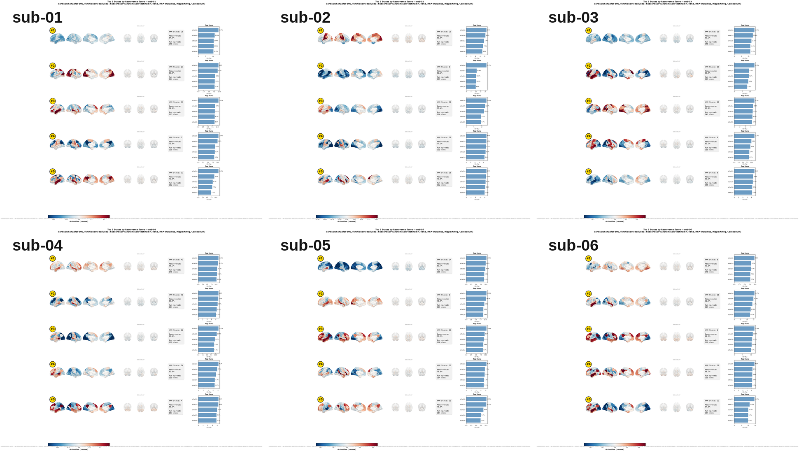

For each subject, the five states ranked highest by recurrence score are rendered on both cortical (Schaefer-100 parcels, fs_LR 32k surface) and subcortical (CIT168 + HCP atlas meshes) surfaces. States are visualized independently per subject; no cross-subject aggregation was applied. Color scaling uses a symmetric range set to the 95th percentile of absolute z-scores pooled across the five displayed states. Subcortical regions with elevated susceptibility artifact (hippocampus, amygdala) carry lower signal-to-noise and should be interpreted with caution.

---

## Figure S2 — PCA loadings diagnostics

All three panels come from one representative participant (sub-01) at the variance threshold used for the main analyses (vt = 0.95, k = 75 retained components).

**Panel A — Loading weights across parcels and components**
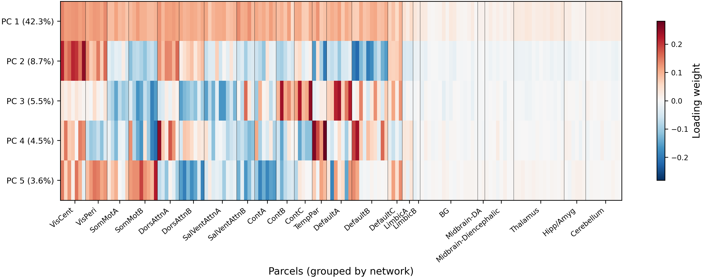

**Panel B — Residual variance by parcel and by network**

**Panel C — Network variance contribution per component**
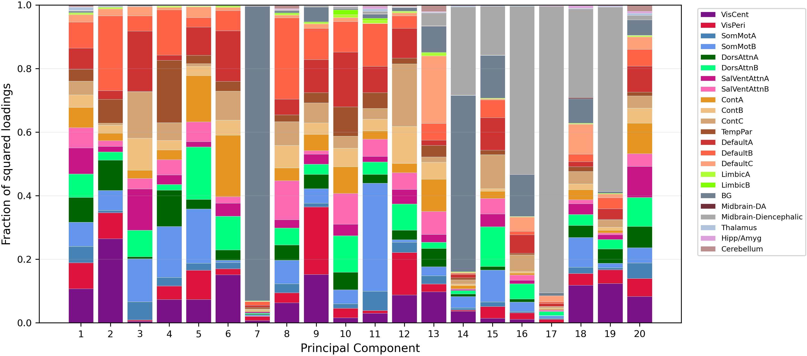

These panels characterize the per-participant PCA space that the combined HMM consumes. Subcortical networks (thalamus, hippocampus/amygdala, basal ganglia) carried the highest residual fractions, while unimodal cortical networks were nearly fully captured by the retained components. Panel C annotates any component that trips the motion-artifact criteria; sub-01 has none, and across the six participants no participant exceeded all criteria simultaneously (one flag on a somatomotor-dominant loading in sub-06; see the linked 03b findings document, which also reports the leave-one-season-out residual-stability diagnostic not shown here).

---

## Figure S3 — HMM model selection

**Panel A — Validation likelihood against occupied states**
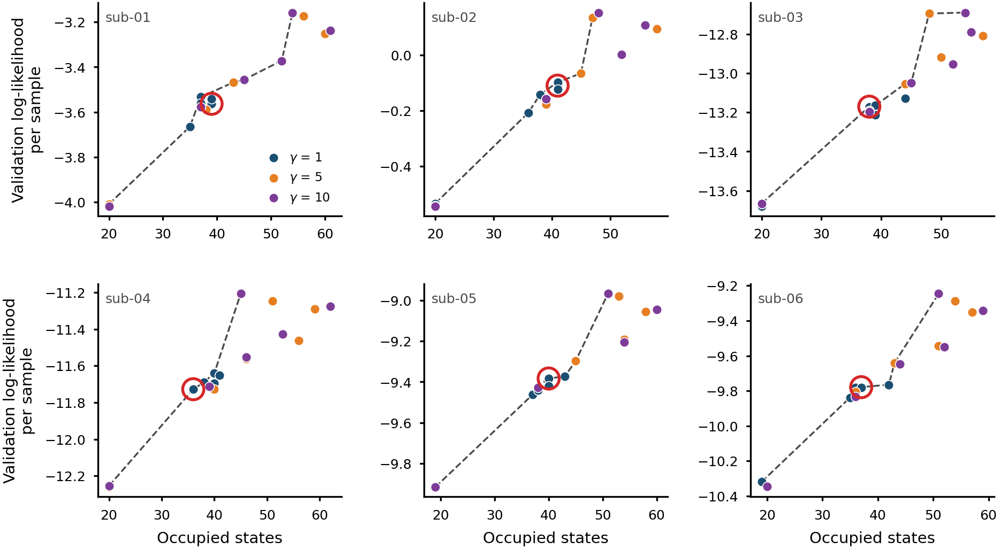

**Panel B — Occupied states against truncation capacity**
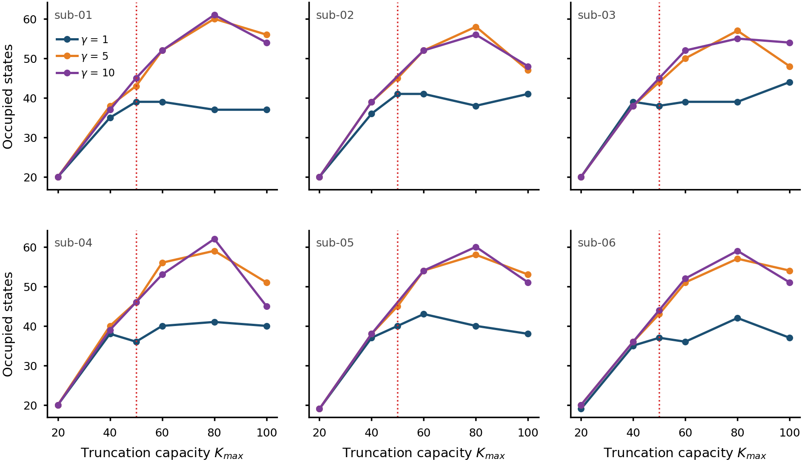

**Panel C — Train-to-validation likelihood gap against capacity**
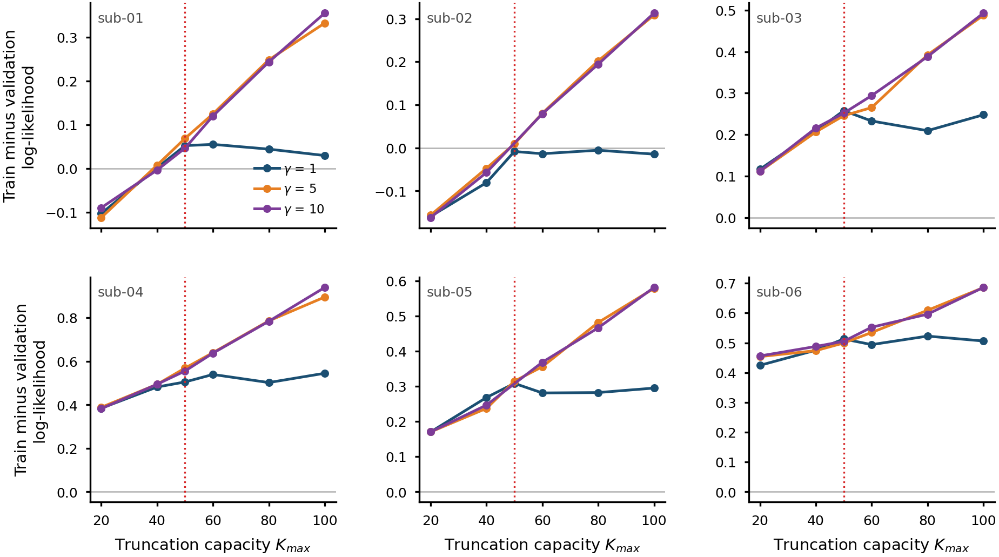

These panels document the configuration choice described in Methods (truncation capacity K_max = 50, concentration γ = 1, sticky bias κ = 10, row concentration α = 1, sticky scale ρ = 1). Each subject contributes its sweep at the main-analysis variance threshold (17–18 configurations at vt = 0.95). A state counts as occupied when its posterior usage at the final EM iteration, over the training and validation data, exceeds 0.01; the per-subject count of occupied states is K_used, the state count against which validation likelihood is traded off in the configuration choice (Panel A). It is not the active-state count used elsewhere, which counts states whose fractional occupancy exceeds 0.02 in at least one run. The selected configuration is ringed in Panel A and marked by the dotted line in Panels B and C.

Panel A shows that validation likelihood keeps rising as configurations admit more occupied states, so likelihood alone does not identify a stopping point; the dashed line is the Pareto frontier, the set of configurations for which no alternative achieves both a higher likelihood and fewer occupied states. Panel B shows why capacity alone does not settle the question either: at γ = 1 the occupied count saturates near 35–44 across capacities from 40 to 100, whereas at γ = 5 and γ = 10 it tracks capacity upward to as many as 62 states. The selected configuration is the simplest one inside the saturated γ = 1 cluster.

Panel A uses a separate y-range per subject, because validation likelihood per sample differs by roughly 10 nats across participants; the panel therefore compares configurations within a participant and not fit quality between participants. In Panel C the selected configuration's gap is smaller than that of every higher-capacity configuration at γ = 5 and γ = 10, but not smaller than the γ = 1 configurations at capacities 80 and 100 for sub-01, sub-02, and sub-03, so the gap advantage holds within a concentration setting rather than across all higher-capacity models. The sweep configurations are also not the model reported in the manuscript. That model is the final refit at the selected configuration: 10 seeds fitted on the combined training and validation data, with the best seed chosen by per-sample likelihood on that data. It occupies 42, 42, 42, 41, 41, and 37 states for sub-01 through sub-06, by the same usage criterion.

---

## Figure S4 — Within-Friends reliability

**Panel A — Matched-pair spatial correlation**
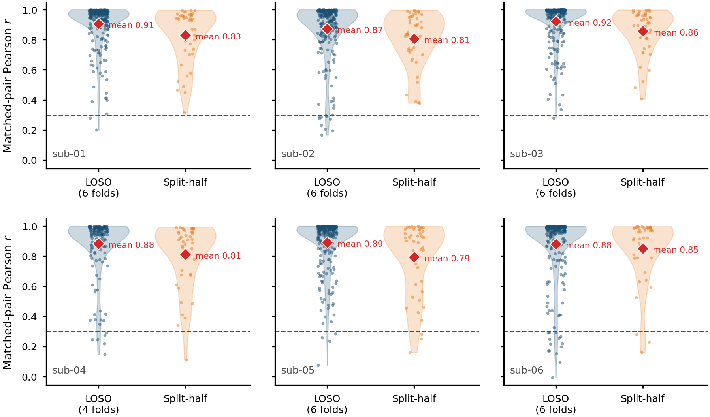

**Panel B — Structural invariants across LOSO folds**
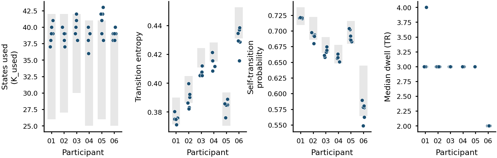

These panels report the two refit procedures described in Methods. Leave-one-season-out (LOSO) refits test whether the repertoire depends on the particular seasons used for fitting; split-half refits partition each subject's episodes by an interleaved odd/even rule and test order-independence. Each refit fits its own PCA on its own training subset, so no held-out data informs the basis. State sets are matched post hoc by the Hungarian algorithm on emission means back-projected to the 156-parcel space.

Panel A is the evidence behind the permissive r > 0.3 matching screen (dashed line). Because the Hungarian algorithm returns a one-to-one pairing for every state, including states with no genuine counterpart, the screen separates substantive matches from forced assignments rather than certifying reproducibility on its own. The distributions sit far above it: mean matched-pair r is 0.87–0.92 across LOSO folds and 0.79–0.86 across split halves, with 94.4–99.6% (LOSO) and 93.0–100% (split-half) of pairs above the screen. The distributions are left-skewed, so the marked mean sits below the median (LOSO medians 0.95–0.99; split-half medians 0.84–0.96). Matching covers each fit's active states (fractional occupancy above 0.02 in at least one run). Fold counts differ by subject: sub-04 contributed four seasons and therefore four folds, the others six.

Panel B places fold-to-fold variability on a scale. Each dot is one LOSO fold; the shaded band is the range across 10 random-seed initializations of the primary model. The band is a relative-scale anchor only and is not a confidence interval. For the occupied-state count (K_used, the same quantity in folds and seeds) the seed range is markedly wider than the fold spread, so the repertoire size is more sensitive to EM initialization than to which season is held out. Median Viterbi dwell time carries no band because the seed-variability record covers K_used, transition entropy, and self-transition probability only. Transition entropy and self-transition probability are computed over each model's K_used states, in folds and seeds alike.

**Panel C — Within-state FC similarity, raw**
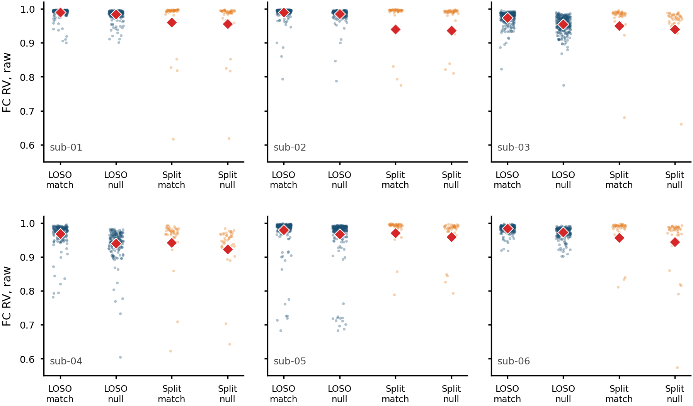

**Panel D — Within-state FC similarity, common mean removed**
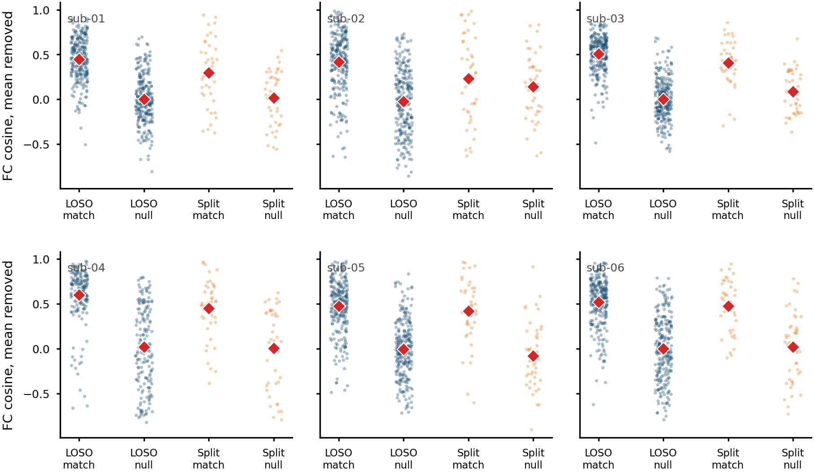

Panels C and D address the caveat that Hungarian matching on mean activation cannot tell whether matched states also share within-state functional connectivity: two states with similar mean maps but different connectivity would be matched anyway. Each panel plots matched pairs alongside a mismatched-pair null, obtained by deranging the target indices so that every comparison is still between two real states from two independent fits. The matched values carry no reference scale without that null, so both appear in each panel.

The RV coefficient on the raw connectivity matrices (Panel C) does not separate matched pairs from mismatched ones. Matched pairs average 0.94–0.99 per participant and refit type, which looks like near-perfect reproduction, but mismatched pairs average 0.92–0.99. The difference is 0.003–0.028. Every within-state connectivity matrix is dominated by a component common to all states, so RV is close to its ceiling regardless of whether the two states correspond, and it cannot flag a mean-only match.

Panel D removes that common component by subtracting each fit's across-state mean connectivity before comparing. The arm then separates: matched pairs average 0.23–0.60 while the mismatched null centres near zero (−0.079 to +0.142), a difference of 0.091–0.582 across participants and refit types. The smallest difference is sub-02's split half (matched 0.232, null 0.142); every other comparison exceeds 0.27. Matched states therefore do share connectivity structure beyond what all states share, and the matches in Panel A are not mean-only. Panel D reports an unclipped cosine rather than RV, because mean-removed matrices are no longer positive semi-definite and 2.3–36.4% of matched pairs are genuinely negatively similar; RV's clip to the interval [0, 1] would hide those and inflate the null.

The remaining arm described in Methods, the split-half recurrence-rank Spearman correlation (ρ = 0.48–0.84, all p < 0.002, recurrence at fractional occupancy above 0.02 per run), appears in main Figure 1D.

---

## Figure S5 — Network-stratified video decoding depth (DINOv2)

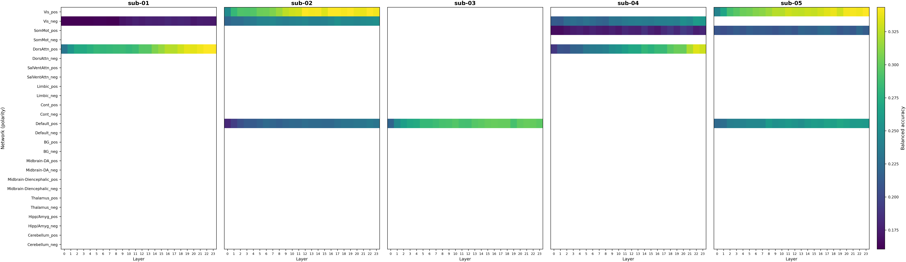

This vision-specific analysis tests whether the DINOv2 video decoding peak localizes to particular brain networks. Each subject contributes one heatmap whose rows are network-by-polarity groups and whose columns are DINOv2-large layers, colored by balanced accuracy; the best lag is fixed at the value from the main depth analysis. Only groups passing the minimum-states and minimum-TR gates are shown, and significance is assessed by Benjamini-Hochberg correction across layers within each group. Sub-06 is absent because all of its network groups fell below the minimum-states gate.

---

## Figure S6 — Run-onset negative control and timing floor

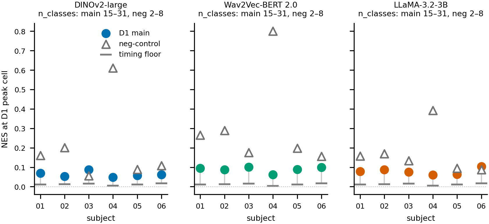

Each panel is one transformer model. For every participant, three quantities are plotted at the cell (lag, layer) where the main content-eligible analysis peaks: the main normalized effect size, the run-onset-anchored negative control, and the timing floor from the six timing and session-position regressors. The grey connector spans the timing floor and the main value.

This panel documents a control that failed. Run-onset-anchored states were intended as a negative control, on the reasoning that occupancy clustered at run or episode boundaries carries timing rather than content information. The control does not work. Its normalized effect size exceeds the main analysis in 16 of the 18 participant-by-model cells (the exceptions are DINOv2 in sub-03, 0.087 against 0.056, and LLaMA in sub-06, 0.104 against 0.088). That advantage is a class-count artifact rather than evidence about content: the control scores 2–8 classes where the main analysis scores 15–31, and normalized effect size is not comparable across different class counts. Sub-04 is the clearest case, with two control classes and a control effect size of 0.39–0.80 against a main value of 0.049–0.061. The label set is also heterogeneous, pooling run-common, a-anchored, and b-anchored states, and the a-anchored subcategory is contaminated by the stereotyped Friends theme song. A class-count-matched redesign is specified but has not been run.

The comparison that stands is therefore the timing floor, which is matched to the main analysis in class count and which the main effect size clears in all 18 cells (main 0.049–0.104 against floor 0.004–0.017). The figure establishes that comparison and retires the run-onset control; it adds no independent evidence about content.

---

## Figure S7 — Decoding depth strips by modality

**Panel A — Audio (Wav2Vec-BERT 2.0)**
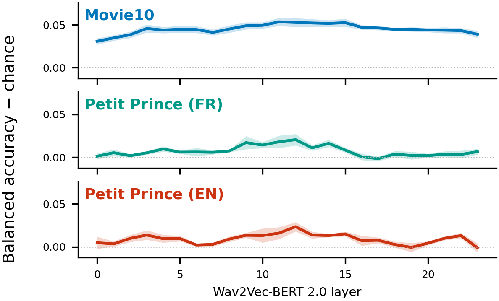

**Panel B — Text (LLaMA-3.2-3B)**
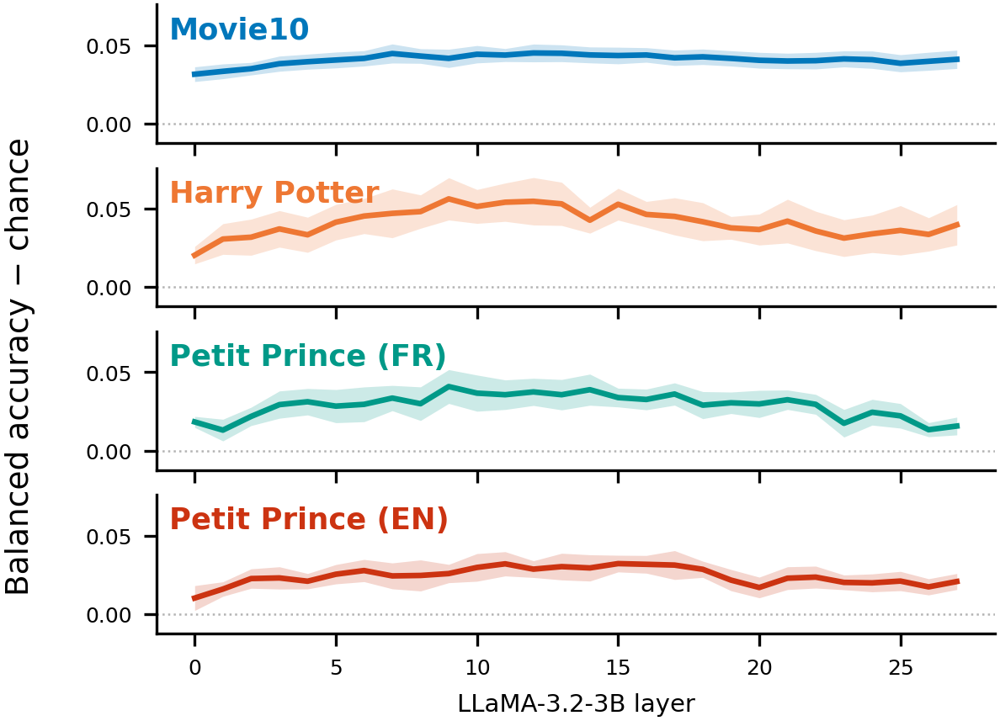

**Panel C — Video (DINOv2-large)**
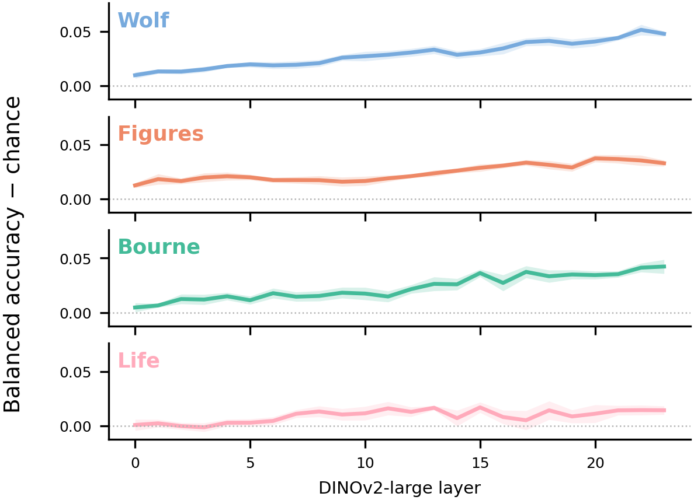

These strips show per-layer decoding accuracy (balanced accuracy minus chance) for the cross-stimulus analysis. For each participant and layer, a classifier fitted to all Friends time points at that participant's best Friends lag is applied without retraining to a held-out stimulus at the same lag. Each panel is one transformer model, and each row is one held-out stimulus: the line is the mean across participants and the shaded band the standard error (n = 6 for Movie10; n = 5 for Harry Potter and Petit Prince, which sub-04 did not complete). The x-axis is the layer index (0 = first block). The stimulus set differs by modality: the audio model (A) covers Movie10 and Petit Prince in both languages; the text model (B) adds Harry Potter; the video model (C) covers the four Movie10 films separately. A mean line above zero does not mean every participant was significant; per-participant significance at the peak layer is counted in Figure 5D.

---

## Figure S8 — Cross-stimulus validity

**Panel A — PCA cross-stimulus fit diagnostic**
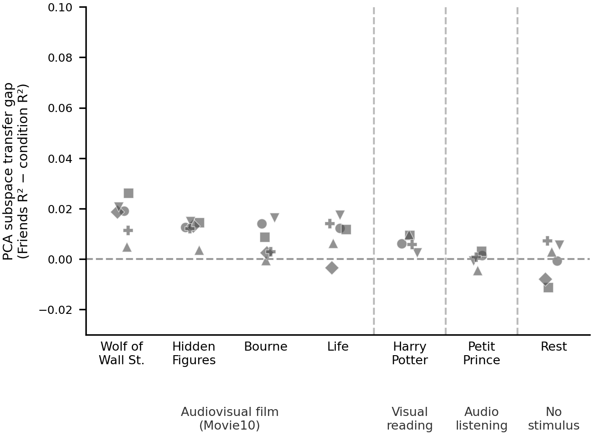

**Panel B — Within-Friends versus cross-stimulus fit**
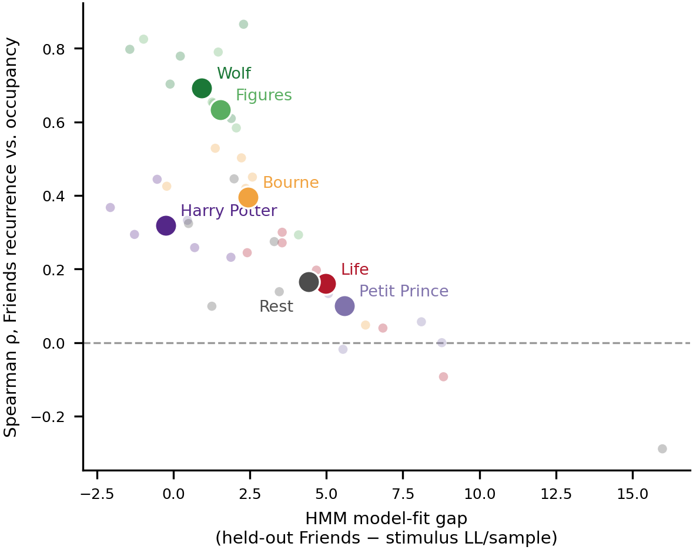

**Panel C — State presence across stimuli**
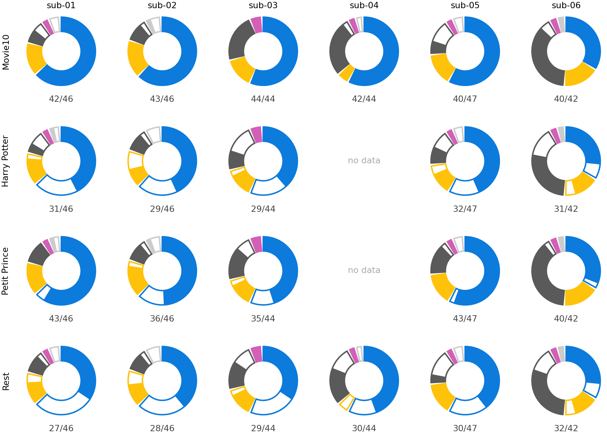

These panels document the cross-stimulus validity checks. Panel A shows that Friends-trained PCA components explained neocortical variance across Movie10, Harry Potter, and Petit Prince with minimal loss; among subcortical groups the thalamus explained least (R² 0.23–0.55 across the held-out stimuli and rest), while the hippocampus/amygdala group stayed at 0.82 or higher. Panel B compares within-Friends HMM fit against cross-stimulus fit. Panel C counts how many Friends-active states were present in each held-out stimulus, using the Friends rule: fractional occupancy above 0.02 in at least one run. Most Friends-active states were present, but not all (Harry Potter 29–32 of 44–47 per subject; rest 27–32 of 42–47). No Friends-inactive state passed the same rule in any held-out stimulus. The rule is less sensitive in the held-out stimuli than in Friends, because they have far fewer runs per subject (7 for Harry Potter and 4–6 for rest, against 194–292 for Friends), so a state that is absent may be rare rather than unused.

Resting state appears in all three panels and is reported here only; it is not part of main Figure 4. All six subjects contributed resting-state data, unlike Harry Potter and Petit Prince, which lack sub-04. The Friends-trained subspace reconstructed rest about as well as it reconstructed the narrative conditions (rest R² 0.943–0.962; per-subject transfer gaps −0.011 to +0.007, Panel A), so the subspace is not stimulus-specific. Temporal fit behaved differently: the held-out-Friends-minus-rest log-likelihood gap spanned 0.49–15.98 per sample, the widest range of any condition, with sub-01 the extreme case (gap 15.98, negative recurrence correspondence). Recurrence correspondence across subjects was ρ = −0.289, 0.324, 0.138, 0.099, 0.274, and 0.445 for sub-01 through sub-06, with two of six reaching uncorrected p < 0.05 (sub-02 p = 0.028; sub-06 p = 0.003). No surrogate null was run for rest, so all rest values are descriptive. Rest's mean ρ (0.165) is not lower than Petit Prince's (0.101), which is expected because raw ρ carries a stimulus-independent covariance and stationarity floor; orderings among the weak conditions are confounded with fit, language, and modality and should not be read as a specificity gradient.

---

## Figure S9 — Individual differences

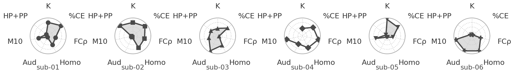

One radar per subject (sub-01 to sub-06, left to right), each with the same seven axes: the number of active states (K), the share of them that are content-eligible (%CE), the FC–transition Mantel correlation (FCρ), the network-homophily ratio (Homo), the relative depth of the audio decoding peak (Aud), the Friends recurrence–Movie10 occupancy correlation (M10), and the mean of the Harry Potter and Le Petit Prince correlations (HP+PP). Each axis is scaled to the cohort minimum–maximum with 10% padding. Sub-04 has no Harry Potter or Le Petit Prince data, so its HP+PP vertex is omitted rather than imputed. Values are shown per subject, without cross-subject averaging. Generated by `script/fig_S09_individual_differences.py` from the 06b transition-structure summaries, the 05e state flags, the 08d audio depth profiles and the m10/hp/pp cross-stimulus summaries.

---

## Figure S10 — ICA convergence diagnostics

**Panel A — K-sweep heatmap**
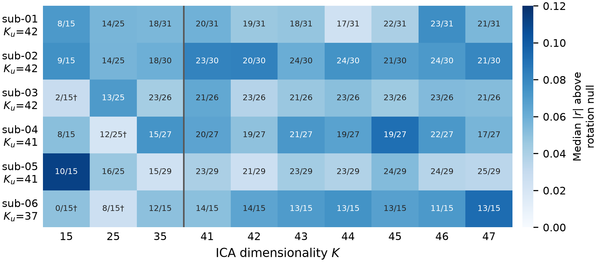

**Panel B — Per-state matched absolute correlation**
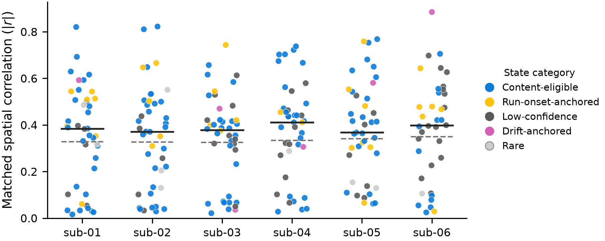

These panels test how far an alternative decomposition with different assumptions recovers the HMM state-mean maps. That alternative is independent component analysis (ICA), which maximizes spatial independence and imposes no temporal model. At each dimensionality K, ICA is fit within the subspace of the top K principal components. Per-pair significance is tested against a **subspace-rotation null**: random rotations of the same centred, whitened top-K basis that ICA rotates, with Hungarian matching re-run per draw (1,000 draws, BH-FDR corrected). Panel A shows, for content-eligible states, how far the median matched absolute correlation (|r|) exceeds the null, with the number of FDR-surviving pairs in each cell and a dagger where a whole-set test of the median is not significant (p ≥ 0.05), for six subjects and each K. Panel B shows the per-state matched |r| at each subject's K_used (the fitted model's occupied-state count, 37–42), coloured by HMM taxonomy category, with the per-subject median (solid) and null mean (dashed). Detailed numerical results are in the findings document on the `supplements` branch (linked in the catalogue table above).

Most of the agreement between the two decompositions comes from the subspace they share: HMM state means lie almost entirely in the leading principal components, so even random rotations of that subspace match them well. Beyond that, ICA's rotation matches the HMM better than the null by +0.02 to +0.11 in median |r|, significantly in 56 of 60 subject × K cells (a 57th, sub-06 at K = 15, lies at the threshold, p = 0.051): in every subject from K = 35 upward, and at K = 15, which is chosen independently of the HMM, in four of six subjects. In most subjects the excess does not grow as K approaches the HMM's state count; in sub-03 and sub-06 convergence is weak at low K and strengthens with K. At K_used, 7–11 ICA components per subject are focal, near-single-parcel sources with no HMM counterpart. These produce the near-zero matches in Panel B, while every HMM state has some ICA map with |r| ≥ 0.30. An independent decomposition therefore converges on the HMM's spatial axes beyond chance but does not reproduce its repertoire state by state. Matches to low-confidence or rare states indicate that those states' mean maps are recoverable within the shared subspace. They are not independent biological or content validation.

---

## Figure S11 — Network participation

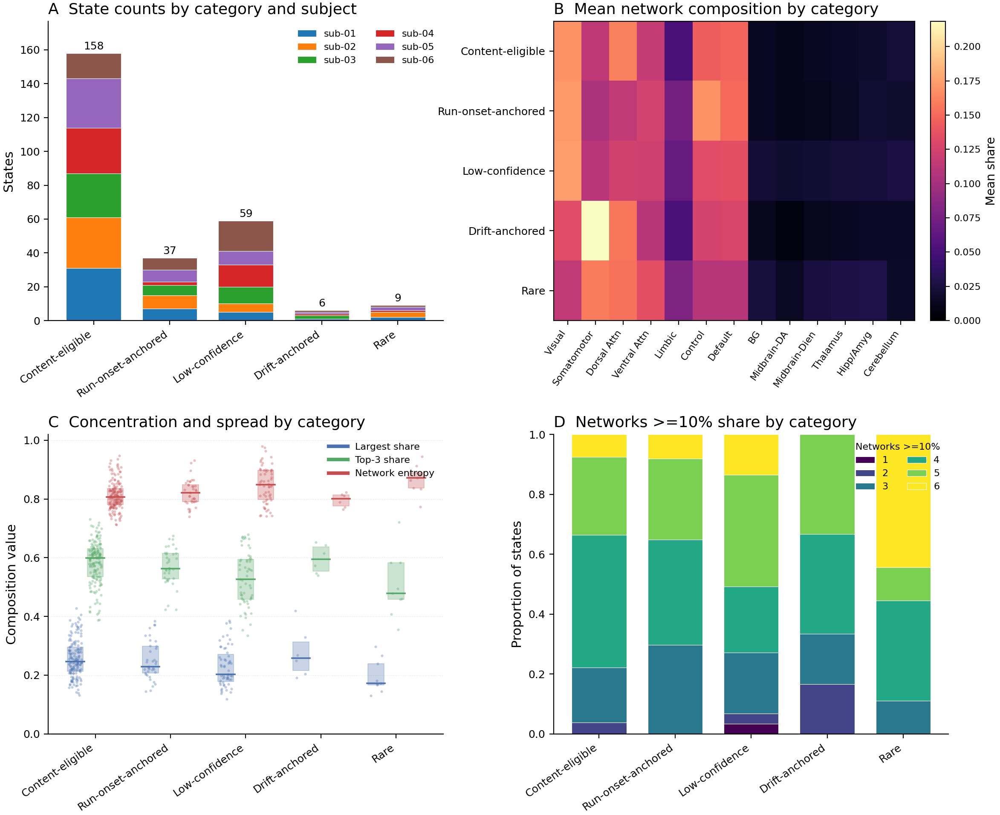

This figure shows how the active states (recurrence > 0; 269 across the six participants) distribute the magnitude of their activation (activation and deactivation alike) across large-scale cortical and subcortical networks, split by the five state categories of Figure 2A: content-eligible (158), run-onset-anchored (37), low-confidence (59), drift-anchored (6) and rare (9). Unused states (recurrence = 0) are outside the active repertoire and are not shown. The categories are screening labels based on temporal criteria, not classes of cognitive state, so differences between the non-eligible categories should not be read biologically.

---

## Figure S12 — ICA out-of-stimulus recurrence

**Movie10 — Winner-take-all assignment**
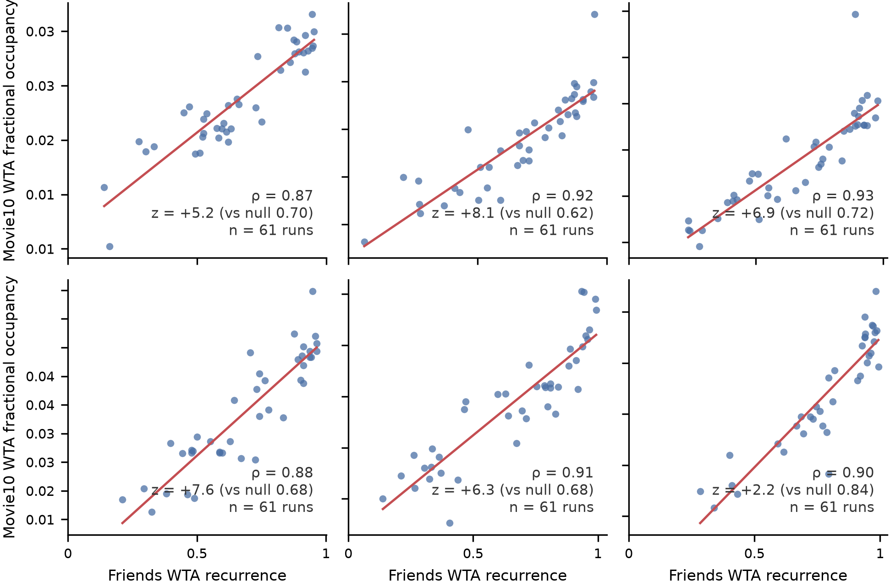

**Movie10 — Continuous assignment**
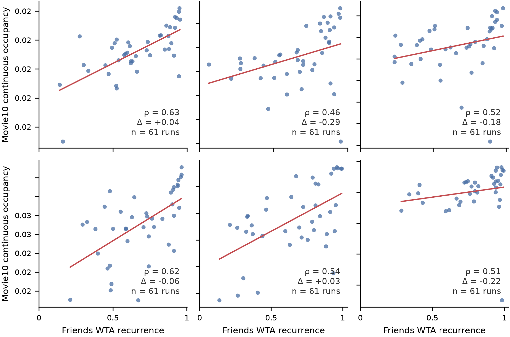

**Harry Potter — Winner-take-all assignment**
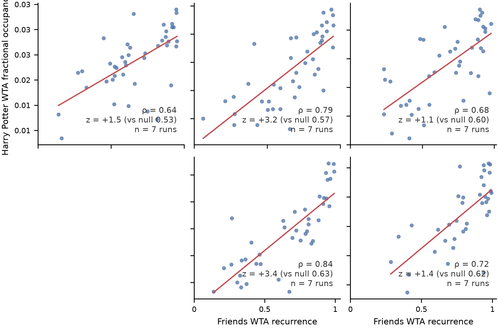

**Harry Potter — Continuous assignment**
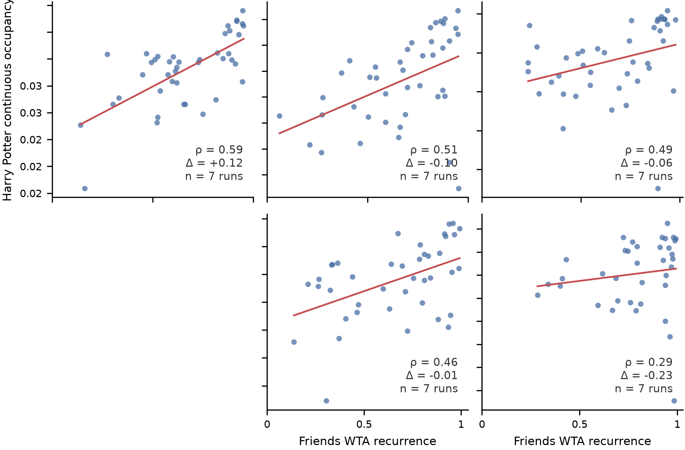

**Petit Prince — Winner-take-all assignment**
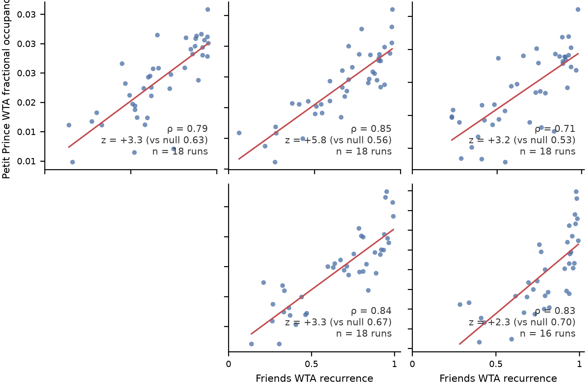

**Petit Prince — Continuous assignment**
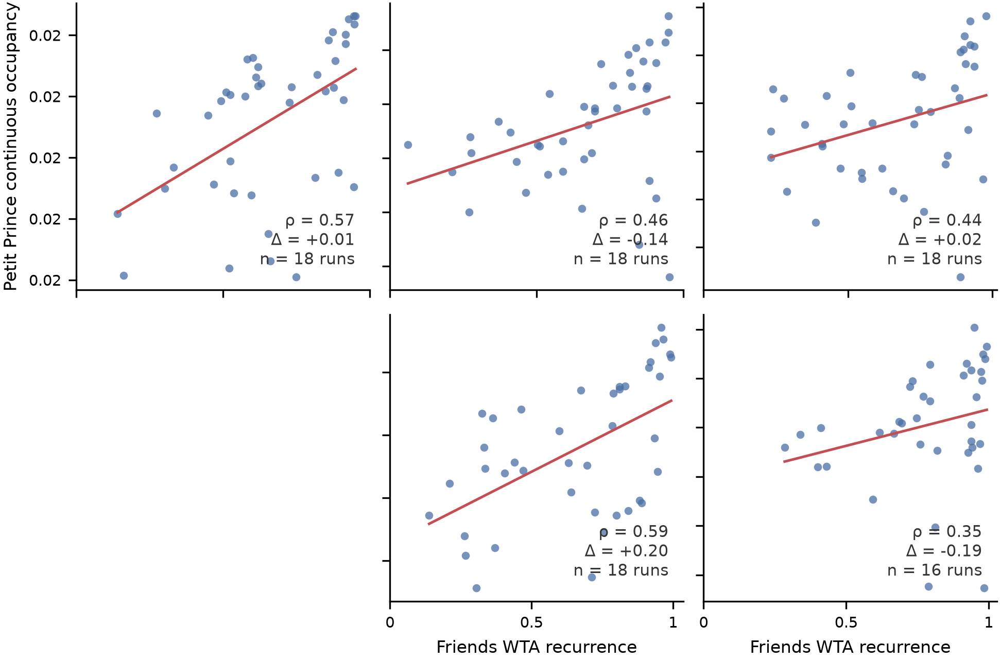

These six panels repeat the out-of-stimulus recurrence test using an ICA-based alternative decomposition in place of the HMM used in the main analysis. Each panel pair presents winner-take-all (hard) and continuous (soft) assignment variants for one held-out stimulus. The three stimuli (Movie10, Harry Potter, and Petit Prince) match those used in the main cross-stimulus recurrence analysis. Detailed numerical results are in the findings document on the `supplements` branch (linked in the catalogue table above).

Two caveats attach to these panels. First, the ICA recurrence score is not on the same footing as the HMM recurrence score used in the main analysis: winner-take-all labelling imposes no dwell structure, so most components exceed the 2% per-run activity threshold in most runs. ICA component recurrence is correspondingly shifted toward the ceiling (per-subject median 0.64–0.81, with 26% of components above 0.9) relative to HMM state recurrence (per-subject median 0.45–0.51, with 3 of 269 states above 0.9). The two distributions are both continuous and broadly graded, but they are not interchangeable, so the ICA panels are not evidence that the main recurrence gradient reproduces under ICA. Second, the continuous-assignment panels are reported for completeness only: against the phase-randomized null the continuous-arm residual is mostly near zero or negative (two of 16 subject–stimulus pairs exceed it, with no consistent pattern), so that arm carries no reliable stimulus-specific signal and does not corroborate the winner-take-all result.

---

## Figure S13 — Phase-randomized null distributions for the Movie10 correlation

One panel per participant, labelled above the panel. The grey histogram is the density of Spearman's ρ across 10,000 phase-randomized surrogate draws; the vertical line marks the observed correlation. All six panels share one horizontal range and one set of bins so the distributions can be compared directly across participants, and the vertical axis is a density with ticks suppressed, since only the shape and the position of the observed value carry information. Each panel is annotated with its own Δρ (observed minus null mean) and z.

This figure shows the distributions that Table S2 tabulates. The observed correlation fell above the surrogate distribution in every participant (Δρ = +0.07 to +0.22; z = +5.97 to +15.62; 61 Movie10 runs and 10,000 draws per participant), while the null distributions themselves sat at substantial correlations: most of the raw correlation's magnitude is reproduced by surrogates that preserve each component's power spectrum and variance together with the cross-component covariance. Table S2 gives the per-participant values and the two limits on what the margin above the null can be attributed to.

This figure shows Movie10; Figure 4B shows Movie10, Harry Potter and Le Petit Prince against their nulls.

---

## Figure S14 — Participant states in one embedding, and the timing of matched states

The content-eligible states of all six participants are embedded together with UMAP (correlation distance on each state's mean activity map relative to the participant's mean, z-scored across the 156 regions; 15 neighbours, minimum distance 0.3, seed 0), as in Figure 2E. The embedding is a display: distances in it are not tested. Generated by `script/fig_F2E_participant_umap.py`.

**A.** As Figure 2E, but each participant pair is matched after the three largest components of a PCA over the other four participants' state maps are projected out of both participants' maps. Color is each state's strongest network and marker shape the participant; line width and opacity grow with the matched correlation, and dark lines mark time-locked matches.

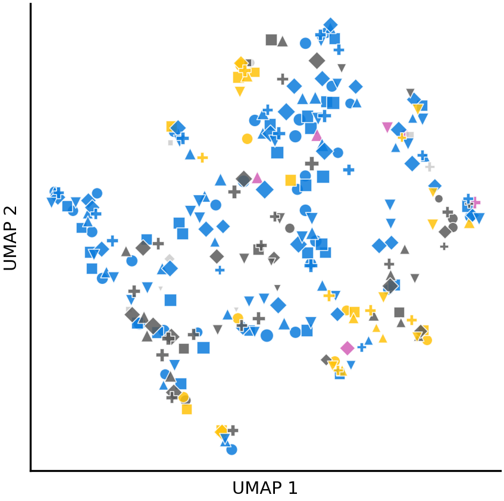

**B.** All active states in their own embedding. Color is the state category (content-eligible, low-confidence, run-onset-anchored, drift-anchored, rare; colors as in Figure 2A), marker shape the participant, and marker area grows with the square root of fractional occupancy.

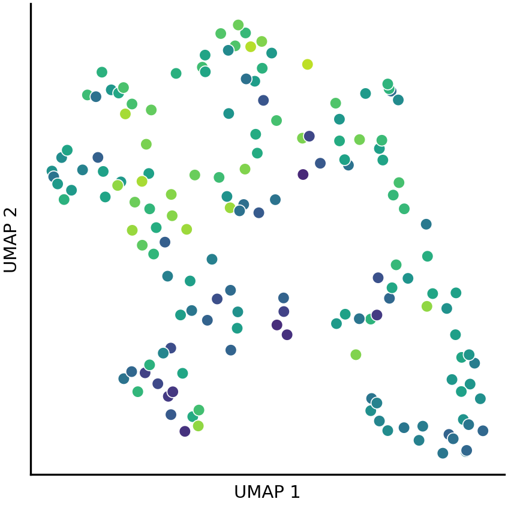

**C.** The content-eligible states of panel A and Figure 2E, colored by recurrence score.

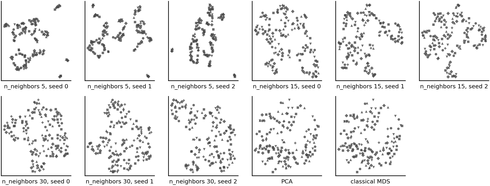

**D.** The same states embedded with UMAP at 5, 15 and 30 neighbours and seeds 0, 1 and 2, and with PCA and classical multidimensional scaling of the same maps; marker shape is the participant.

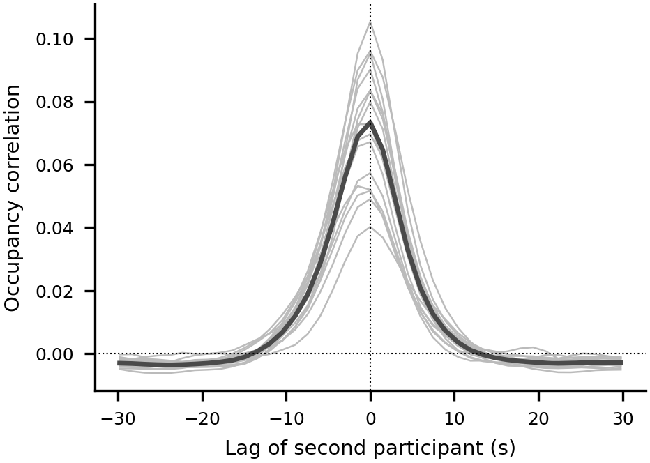

**E.** Occupancy correlation of every matched pair of states (all matches, not only the time-locked ones) when the second participant's state sequence is shifted by up to 20 TRs (about 30 s) within each run. Thin lines are the mean per participant pair; the thick line is the mean over all matches. The value at zero lag is the occupancy correlation used for the time-locking test. Values are also written to `lagged_locking.json`.

Legends: [networks](figures/S14_participant_umap_legend_networks.png) (A), [participants](figures/S14_participant_umap_legend_participants.png) (A, B, D), [state categories](figures/S14_participant_umap_legend_categories.png) (B), [recurrence score](figures/S14_participant_umap_legend_recurrence.png) (C).

---

## Figure S15 — Similarity of the states within transition modules

Each participant's states are ordered as in Figure 3A: by the transition modules of the model's transition matrix (modules sorted by the recurrence of their most recurrent state, states within a module by recurrence), with mid-grey lines between modules. Colored ribbons on the top and left edges give each state's dominant network, and dots mark states excluded from content analyses. Both matrices are symmetric, and the diagonal is left white. Generated by `script/fig_F3_transition_structure.py`; the within- minus between-module differences and the co-membership model coefficients for each measure are written to `si_transition_modules_similarity_stats.json`.

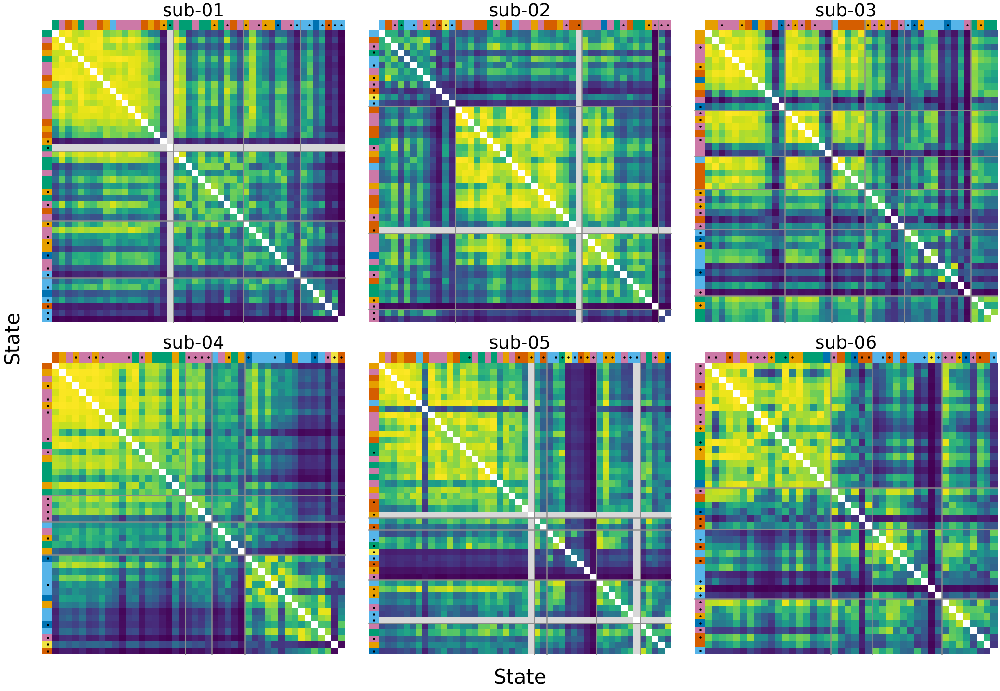

**A.** Within-state functional-connectivity similarity: the RV coefficient between two states' within-state correlation matrices, the measure correlated with transition probability in Figure 3B. RV lies between 0.9 and 1 for nearly all pairs, so each cell shows the pair's percentile among that participant's state pairs. States with too few time points for a within-state correlation matrix are shown as light grey rows and columns.

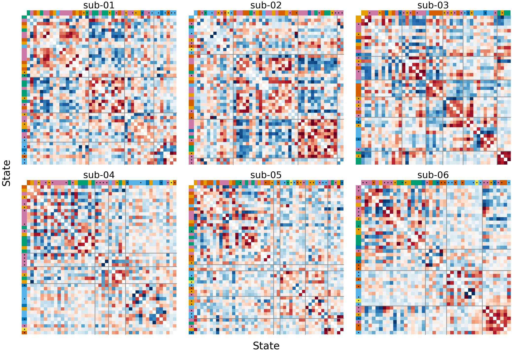

**B.** Activation-map similarity: the Pearson correlation across the 156 regions between two states' mean activity maps, relative to the participant's mean, on one diverging scale shared by all participants and limited to ±0.8; the 43 state pairs beyond these limits, across the six participants, take the end colors, as the arrows on the legend indicate.

Legends: [FC similarity](figures/S15_transition_module_similarity_legend_fc.png) (A), [map similarity](figures/S15_transition_module_similarity_legend_maps.png) (B), [networks](figures/S15_transition_module_similarity_legend_networks.png) (A, B).

---

## Note on the `supplements` branch

Figures S10, S12, and S13 derive from analyses run under a separate computational environment maintained on the orphan `supplements` branch of this repository. That branch holds its own `uv`-managed Python project, flat-named findings documents (`sm_alt_ica_states.md`, `sm_alt_ica_oos_recurrence.md`, `sm_rel_r5_phase_null.md`), and rendered outputs; it shares no commit history with `main`. The findings links for those figures in the catalogue table above point directly to those files on GitHub.

---

## Supplementary Tables

Supplementary tables are numbered separately from supplementary figures.

| Table | What it shows | Findings / source | Branch |
|-------|---------------|-------------------|--------|
| S1 | Random-direction null for the network-spread index of content-eligible state maps, per participant | [sm_rel_r2_network_spread.md](https://github.com/yibeichan/brain-states-friends/blob/supplements/docs/findings/sm_rel_r2_network_spread.md) | supplements |
| S2 | Phase-randomized null for the Movie10 recurrence–occupancy correlation, per participant | [sm_rel_r5_phase_null.md](https://github.com/yibeichan/brain-states-friends/blob/supplements/docs/findings/sm_rel_r5_phase_null.md) | supplements |
| S3 | Cross-stimulus recurrence–occupancy correlation on the full active repertoire and on content-eligible states alone, per participant and stimulus | [m10](../findings/m10_05_cross_stimulus_validation.md), [hp](../findings/hp_05_cross_stimulus_validation.md), [pp](../findings/pp_05_cross_stimulus_validation.md) | main |
| S4 | Matching of content-eligible states between participants, per pair: matched map correlation against the state-mixing null, the same after removing network means or the components shared with the other participants, and moment-to-moment time-locking of matched states | [05h_participant_state_matching.md](../findings/05h_participant_state_matching.md) | main |
| S5 | Module co-membership, per participant: joint MRQAP coefficients for seven pairwise relations between states, and within-module minus between-module means | [06e_transition_modules.md](../findings/06e_transition_modules.md) | main |
| S6 | Transition modularity for every participant, graph variant and null, with the decision rule, held-out-season folds and the further criteria | [06e_transition_modules.md](../findings/06e_transition_modules.md) | main |
| S7 | fMRIPrep release and slice-timing correction of the analysed Friends runs, per participant and season, and state-occupancy contrasts within the seasons that mixed preprocessing | `script/preproc_by_season.py` | main |
| S8 | Association between within-state FC similarity and transitions after removing the FC shared by all states, and after controlling for state TR counts and activation-map similarity, per participant | [sm_rel_r6_fc_transition_controls.md](https://github.com/yibeichan/brain-states-friends/blob/supplements/docs/findings/sm_rel_r6_fc_transition_controls.md) | supplements |
| S9 | Agreement between each held-out season's transition modules and the main partition, per participant and fold | [sm_rel_r7_loso_module_agreement.md](https://github.com/yibeichan/brain-states-friends/blob/supplements/docs/findings/sm_rel_r7_loso_module_agreement.md) | supplements |
| S10 | Structure results at five other hyperparameter settings (number of states the model may use, top-level concentration, PCA variance), per participant: active and content-eligible states, transition-module Q excess, FC–transition and MFPT–FC ρ, and the Movie10 Δρ | `script/sens_collect.py` | main |

### Table S1 — Random-direction null for the network-spread index

Random-direction null for the network-spread index, per participant (10,000 draws; two-sided empirical p floor 0.0002; vm = variance-matched, iso = equal-weight). The network-spread index is the Shannon entropy of a state's 13-network composition normalized by log(13), so 0 means all weight in one network and 1 means weight spread evenly across networks.

| Participant | Eligible states | Observed spread | vm null median [95% CI] | vm z | iso null median | iso z | Observed top-1 share | vm null top-1 (z) |
|---|---|---|---|---|---|---|---|---|
| sub-01 | 31 | 0.793 | 0.927 [0.918, 0.937] | -27.1 | 0.954 | -43.9 | 0.256 | 0.168 (+14.1) |
| sub-02 | 30 | 0.818 | 0.933 [0.924, 0.942] | -25.6 | 0.954 | -37.9 | 0.249 | 0.163 (+14.4) |
| sub-03 | 26 | 0.801 | 0.925 [0.914, 0.935] | -22.6 | 0.957 | -39.7 | 0.243 | 0.171 (+10.4) |
| sub-04 | 27 | 0.788 | 0.921 [0.910, 0.931] | -25.0 | 0.948 | -42.3 | 0.253 | 0.171 (+11.9) |
| sub-05 | 29 | 0.825 | 0.933 [0.923, 0.942] | -21.9 | 0.958 | -37.0 | 0.241 | 0.164 (+12.0) |
| sub-06 | 15 | 0.809 | 0.932 [0.918, 0.945] | -17.6 | 0.956 | -27.9 | 0.224 | 0.164 (+6.7) |

Fitted states were more network-concentrated than random directions in every participant and under both null variants. Observed spread ranged 0.79 to 0.83 across participants, against variance-matched null medians of 0.92 to 0.93 (z = -18 to -27) and equal-weight null medians of 0.95 to 0.96 (z = -28 to -44), with the observed largest-network share correspondingly above the null (0.22 to 0.26 versus about 0.17); the two-sided empirical p reached the 10,000-draw floor of 0.0002 in every participant. Pooled across the 158 content-eligible states, the observed spread index was 0.807 against a variance-matched null median of 0.929 (95% interval 0.924 to 0.933; z = -56.9).

The comparison holds the participant's retained principal-component subspace fixed and redraws directions within it, so it tests whether the multi-network composition of the fitted states is inherited from the principal-component basis. It is not: the fitted states are substantially more network-structured than arbitrary patterns in the same subspace, while still drawing on several networks each.

**Provenance.** Generated by `script/sm_rel_r2_network_spread.py` on the orphan `supplements` branch; per-participant values read from `$SCRATCH_DIR/output/sm_rel_r2_network_spread/atlas-4S156Parcels//vt0.95/r2_network_spread_summary.json` and the pooled row from `pooled_summary.json` in the same tree. The observed per-participant spread values reproduce the independently computed per-subject medians in `fig2_C_network_participation_summary.json` (Figure 2C pipeline) exactly.

### Table S2 — Phase-randomized null for the Movie10 recurrence–occupancy correlation

Phase-randomized null for the Movie10 recurrence–occupancy correlation, per participant (10,000 draws; empirical p floor 0.0001). [Figure S13](#figure-s13--phase-randomized-null-distributions-for-the-movie10-correlation) plots the corresponding null distributions with the observed correlation marked. Surrogates are shared-phase Prichard–Theiler surrogates of the Movie10 principal-component scores: they preserve each component's power spectrum and variance, the cross-component covariance, the run count, and the run lengths, while destroying stimulus-locked phase alignment along with all higher-order temporal structure.

| Participant | Movie10 runs | Observed rho | Null mean (SD) | Null 2.5–97.5% | Delta rho | z | Empirical p | Null share of observed |
|---|---|---|---|---|---|---|---|---|
| sub-01 | 61 | 0.549 | 0.450 (0.016) | 0.417–0.481 | +0.098 | +6.11 | 0.0001 | 82% |
| sub-02 | 61 | 0.264 | 0.136 (0.016) | 0.104–0.166 | +0.127 | +8.00 | 0.0001 | 52% |
| sub-03 | 61 | 0.518 | 0.294 (0.025) | 0.244–0.341 | +0.224 | +9.02 | 0.0001 | 57% |
| sub-04 | 61 | 0.753 | 0.684 (0.012) | 0.661–0.706 | +0.069 | +5.97 | 0.0001 | 91% |
| sub-05 | 61 | 0.610 | 0.397 (0.014) | 0.371–0.424 | +0.212 | +15.62 | 0.0001 | 65% |
| sub-06 | 61 | 0.773 | 0.660 (0.016) | 0.629–0.689 | +0.114 | +7.28 | 0.0001 | 85% |

The observed correlation exceeded the null in every participant at the 10,000-draw floor (p = 0.0001; z = +5.97 to +15.62). The null mean was itself large (rho = 0.14 to 0.68, accounting for 52% to 91% of the observed correlation), so most of the raw correlation's magnitude is compatible with the preserved spectral and covariance structure alone; the margin above the null expectation was modest but consistent across participants (delta rho = +0.07 to +0.22).

The margin has two limits. First, it is a distance above the null expectation, not an additive stimulus-specific component, because a Spearman correlation does not decompose additively. Second, because phase randomization destroys all phase-borne structure rather than stimulus-locking alone, exceeding the null rules out the preserved spectra and covariance as a *complete* account of the correlation, but does not by itself attribute the margin to stimulus-locked dynamics rather than to other phase-borne temporal structure.

The table covers Movie10. The same null was run on Harry Potter (7 runs per participant) and Le Petit Prince (16–18 runs, against 61 for Movie10). For Harry Potter the observed correlation sits above its null in one participant (sub-05, z = +2.77), near it in two (z = −0.64 and +0.29) and below it in two (z = −2.41 and −3.22). For Le Petit Prince it sits above its null in two (sub-01, z = +2.24; sub-05, z = +9.08, where the null lies below zero and the observed correlation is near zero) and at it in three (z = 0.11–0.29). Figure 4B shows all three stimuli against their nulls; the findings document gives per-participant values.

**Provenance.** Generated by `script/sm_rel_r5_phase_null.py` on the orphan `supplements` branch, deterministically seeded (draw *s* uses `numpy.random.default_rng(seed_base + s)` with `seed_base = 0`), so the table is reproducible. Per-participant values read from `$SCRATCH_DIR/output/sm_rel_r5_phase_null/atlas-4S156Parcels//vt0.95/r5_phase_null_summary.json`. Each summary carries a faithfulness gate confirming the recomputed observed rho reproduces the published value (|delta| = 0 at tolerance 1e-12 in all six participants). Every range quoted in the main text (null mean rho, null share of observed, delta rho, and z) matches these files exactly.

### Table S3 — Cross-stimulus correlation on the full repertoire and on content-eligible states

Per-participant Spearman correlation between the Friends recurrence score and mean fractional occupancy under each held-out stimulus, computed twice: on the full active repertoire (every state with recurrence > 0, the analysis plotted in Figure 4) and on content-eligible states alone. Content eligibility is the screening taxonomy from `05e_a4`, which removes sub-HRF, run-onset-anchored, drift-anchored, and rare states. The active-state counts here (42–47) run above the occupied-state counts of the fitted models (37–42, Figure S3) because the two criteria differ: a state counts as active here when its fractional occupancy exceeds 0.02 in at least one run, and as occupied in Figure S3 when its posterior usage in the fitted model, pooled over the training and validation data, exceeds 0.01. All p-values are uncorrected and approximate, because fractional occupancy is compositional within a run; sub-04 contributed no Harry Potter or Le Petit Prince data.

| Stimulus | Participant | Active states | ρ (all active) | p | Content-eligible states | ρ (eligible) | p |
|---|---|---|---|---|---|---|---|
| Movie10 | sub-01 | 46 | +0.549 | <0.001 | 31 | +0.301 | 0.100 |
| Movie10 | sub-02 | 46 | +0.264 | 0.077 | 30 | −0.082 | 0.665 |
| Movie10 | sub-03 | 44 | +0.518 | <0.001 | 26 | +0.457 | 0.019 |
| Movie10 | sub-04 | 44 | +0.753 | <0.001 | 27 | +0.657 | <0.001 |
| Movie10 | sub-05 | 47 | +0.610 | <0.001 | 29 | +0.502 | 0.006 |
| Movie10 | sub-06 | 42 | +0.773 | <0.001 | 15 | +0.779 | <0.001 |
| Harry Potter | sub-01 | 46 | +0.232 | 0.121 | 31 | +0.223 | 0.227 |
| Harry Potter | sub-02 | 46 | +0.444 | 0.002 | 30 | +0.343 | 0.063 |
| Harry Potter | sub-03 | 44 | +0.367 | 0.014 | 26 | +0.404 | 0.041 |
| Harry Potter | sub-05 | 47 | +0.258 | 0.080 | 29 | −0.028 | 0.887 |
| Harry Potter | sub-06 | 42 | +0.294 | 0.059 | 15 | +0.191 | 0.495 |
| Le Petit Prince | sub-01 | 46 | +0.056 | 0.710 | 31 | +0.053 | 0.778 |
| Le Petit Prince | sub-02 | 46 | +0.332 | 0.024 | 30 | +0.287 | 0.124 |
| Le Petit Prince | sub-03 | 44 | +0.133 | 0.389 | 26 | +0.178 | 0.384 |
| Le Petit Prince | sub-05 | 47 | −0.000 | 0.998 | 29 | −0.273 | 0.153 |
| Le Petit Prince | sub-06 | 42 | −0.018 | 0.908 | 15 | +0.093 | 0.742 |

The restriction lowers the correlation in most cells, but not in all: it raises ρ for Movie10 in sub-06, for Harry Potter in sub-03, and for Le Petit Prince in sub-03 and sub-06. The audiovisual ordering survives the restriction. Movie10 remains the strongest of the three conditions in every participant who contributed all three except sub-02 (that is, in sub-01, sub-03, sub-05, and sub-06), and sub-02 is the same exception under the full repertoire. The two reduced-modality stimuli stay weak and variable under both state sets.

The restriction has two consequences for the p-values. First, it removes between a third and two-thirds of each participant's states (33% in sub-01 up to 64% in sub-06), so 42–47 active states become 15–31 content-eligible ones and any correlation is estimated from far fewer points, raising its p-value on sample size alone. Harry Potter in sub-02 shows what that looks like: the correlation falls modestly, from ρ = +0.444 to +0.343, while its p rises from 0.002 to 0.063, so the change in significance is larger than the change in the correlation itself. Second, the screening removes states by temporal criteria that are not independent of occupancy, so the restricted repertoire is not a random subsample of the active one. For both reasons the two arms bracket the correspondence rather than forming a test and its confirmation, and counting significant cells across the table would not be meaningful.

**Provenance.** Read from `A1_recurrence_correlation` (all active states) and `A1_recurrence_correlation_eligible` (content-eligible) in `$SCRATCH_DIR/output/{m10,hp,pp}_05_cross_validation/atlas-4S156Parcels//vt0.95/cross_stimulus_summary.json`, with eligibility flags from `05e_a4`. Every cell was taken from those files rather than transcribed from the findings documents, and the two agree. The full-repertoire values for sub-02 are the ones quoted in the Figure 4 caption (Movie10 ρ = +0.264, Harry Potter ρ = +0.444, Le Petit Prince ρ = +0.332).

### Table S4 — Matching of content-eligible states between participants

Per participant pair, content-eligible states matched one-to-one by map correlation (all parcels; Hungarian matching). Median r is the median matched correlation, against the mean of the state-mixing null (1,000 draws; one participant's centred maps mixed by a random orthogonal matrix, which keeps each repertoire's mean map and spatial covariance). q is Benjamini–Hochberg corrected across the 15 pairs (p floor 1/1001). Within-network r is the same matching after each region's network mean is removed, and top-3 removed r after removing the three largest components of the other four participants' maps (each with its own null mean). Locking r is the mean moment-to-moment occupancy correlation of matched states over shared runs, against a circular-shift null; time-locked counts matches above the pair's family-wise threshold.

| Pair | States | Median r (null mean) | q | Within-network r (null) | Top-3 removed r (null) | Locking r (shift null) | Time-locked matches |
|---|---|---|---|---|---|---|---|
| sub-01 / sub-02 | 31 x 30 | 0.726 (0.593) | 0.0012 | 0.658 (0.502) | 0.544 (0.462) | 0.0961 (0.0013) | 24 of 30 |
| sub-01 / sub-03 | 31 x 26 | 0.653 (0.573) | 0.0012 | 0.643 (0.502) | 0.535 (0.463) | 0.1054 (0.0014) | 18 of 26 |
| sub-01 / sub-04 | 31 x 27 | 0.600 (0.528) | 0.0023 | 0.547 (0.450) | 0.566 (0.465) | 0.0517 (0.0006) | 16 of 27 |
| sub-01 / sub-05 | 31 x 29 | 0.688 (0.565) | 0.0012 | 0.631 (0.470) | 0.581 (0.449) | 0.0835 (0.0010) | 22 of 29 |
| sub-01 / sub-06 | 31 x 15 | 0.701 (0.593) | 0.0012 | 0.654 (0.527) | 0.556 (0.466) | 0.0520 (0.0007) | 10 of 15 |
| sub-02 / sub-03 | 30 x 26 | 0.688 (0.581) | 0.0012 | 0.636 (0.519) | 0.522 (0.456) | 0.0727 (0.0014) | 18 of 26 |
| sub-02 / sub-04 | 30 x 27 | 0.619 (0.541) | 0.0050 | 0.527 (0.464) | 0.549 (0.473) | 0.0573 (0.0004) | 17 of 27 |
| sub-02 / sub-05 | 30 x 29 | 0.734 (0.571) | 0.0012 | 0.654 (0.483) | 0.605 (0.463) | 0.0697 (0.0009) | 20 of 29 |
| sub-02 / sub-06 | 30 x 15 | 0.678 (0.594) | 0.0032 | 0.623 (0.525) | 0.540 (0.480) | 0.0672 (0.0010) | 8 of 15 |
| sub-03 / sub-04 | 26 x 27 | 0.804 (0.550) | 0.0012 | 0.736 (0.492) | 0.662 (0.478) | 0.0800 (0.0009) | 16 of 26 |
| sub-03 / sub-05 | 26 x 29 | 0.756 (0.559) | 0.0012 | 0.663 (0.501) | 0.594 (0.442) | 0.0835 (0.0006) | 16 of 26 |
| sub-03 / sub-06 | 26 x 15 | 0.819 (0.610) | 0.0012 | 0.731 (0.566) | 0.703 (0.508) | 0.0902 (0.0014) | 11 of 15 |
| sub-04 / sub-05 | 27 x 29 | 0.626 (0.519) | 0.0012 | 0.609 (0.453) | 0.561 (0.459) | 0.0403 (0.0004) | 14 of 27 |
| sub-04 / sub-06 | 27 x 15 | 0.795 (0.585) | 0.0012 | 0.738 (0.518) | 0.681 (0.509) | 0.0953 (0.0019) | 9 of 15 |
| sub-05 / sub-06 | 29 x 15 | 0.702 (0.565) | 0.0012 | 0.612 (0.478) | 0.575 (0.456) | 0.0491 (0.0007) | 9 of 15 |

Matched states were more similar than the state-mixing null in all 15 pairs, and remained so with network means removed (q ≤ 0.009) and with the shared components removed (q ≤ 0.014). Matched states were weakly time-locked in every pair; 228 of 348 matches passed individually.

**Provenance.** `script/05h_participant_state_matching.py`; values from `$SCRATCH_DIR/output/05h_participant_state_matching/atlas-4S156Parcels/`. Every variant, the ceiling comparison and the timing-property checks are in [05h_participant_state_matching.md](../findings/05h_participant_state_matching.md).

### Table S5 — Module co-membership

For each participant, which pairwise relations between states predict whether two states share a transition module (states with a defined within-state FC; 42–45 per participant). Part A enters all seven relations together in a multiple-regression quadratic assignment model of co-membership (Dekker semi-partialling); part B compares each relation's mean between pairs in the same module and pairs in different modules, against permutations of module labels that keep module sizes. Values are β or difference, with two-sided p from 5,000 permutations (floor 0.0002, shown as p < 0.001).

**A. Joint co-membership model (MRQAP): β (permutation p, 5,000 permutations, two-sided)**

| Predictor | sub-01 | sub-02 | sub-03 | sub-04 | sub-05 | sub-06 |
|---|---|---|---|---|---|---|
| FC similarity (RV) | +3.062 (p = 0.52) | +1.345 (p = 0.77) | +0.780 (p = 0.64) | +3.318 (p = 0.008) | -3.830 (p = 0.05) | +3.284 (p = 0.33) |
| Activation-map correlation | +0.318 (p < 0.001) | +0.342 (p < 0.001) | +0.287 (p < 0.001) | +0.085 (p = 0.05) | +0.087 (p = 0.11) | +0.229 (p < 0.001) |
| Bhattacharyya distance | -0.037 (p = 0.37) | -0.085 (p = 0.02) | -0.020 (p = 0.43) | -0.006 (p = 0.89) | -0.119 (p = 0.005) | -0.022 (p = 0.61) |
| Same dominant network | +0.056 (p = 0.10) | +0.016 (p = 0.62) | +0.137 (p < 0.001) | +0.000 (p = 1.00) | +0.065 (p = 0.08) | +0.042 (p = 0.23) |
| Absolute recurrence difference | -0.232 (p = 0.04) | -0.267 (p = 0.02) | +0.051 (p = 0.44) | -0.095 (p = 0.39) | +0.045 (p = 0.83) | -0.103 (p = 0.23) |
| Co-occurrence across runs | +1.045 (p < 0.001) | +1.176 (p < 0.001) | +1.283 (p < 0.001) | +1.199 (p < 0.001) | +0.938 (p < 0.001) | +1.355 (p < 0.001) |
| Co-occurrence across seasons | +0.014 (p = 0.61) | +0.001 (p = 0.96) | -0.055 (p = 0.03) | -0.073 (p = 0.001) | -0.034 (p = 0.25) | -0.080 (p = 0.005) |

**B. Within-module minus between-module mean (label-permutation p, 5,000 permutations, two-sided)**

| Measure | sub-01 | sub-02 | sub-03 | sub-04 | sub-05 | sub-06 |
|---|---|---|---|---|---|---|
| FC similarity (RV) | +0.005 (p < 0.001) | +0.004 (p < 0.001) | +0.005 (p = 0.001) | +0.023 (p < 0.001) | +0.018 (p = 0.02) | +0.007 (p < 0.001) |
| Activation-map correlation | +0.161 (p < 0.001) | +0.221 (p < 0.001) | +0.222 (p < 0.001) | +0.019 (p = 0.30) | +0.073 (p = 0.001) | +0.120 (p < 0.001) |
| Bhattacharyya distance | -0.600 (p < 0.001) | -0.692 (p < 0.001) | -0.326 (p < 0.001) | -0.440 (p < 0.001) | -1.186 (p < 0.001) | -0.577 (p < 0.001) |
| Same dominant network | +0.092 (p = 0.01) | +0.019 (p = 0.57) | +0.173 (p < 0.001) | +0.154 (p = 0.001) | +0.052 (p = 0.05) | +0.156 (p < 0.001) |
| Absolute recurrence difference | -0.079 (p < 0.001) | -0.087 (p < 0.001) | -0.064 (p = 0.003) | -0.132 (p < 0.001) | -0.063 (p = 0.007) | -0.121 (p < 0.001) |
| Co-occurrence across runs | +0.070 (p < 0.001) | +0.076 (p < 0.001) | +0.103 (p < 0.001) | +0.333 (p < 0.001) | +0.098 (p < 0.001) | +0.241 (p < 0.001) |
| Co-occurrence across seasons | +0.155 (p = 0.002) | +0.150 (p = 0.002) | +0.149 (p = 0.003) | +0.125 (p = 0.01) | +0.184 (p < 0.001) | +0.258 (p < 0.001) |

Co-occurrence across runs was the strongest predictor of sharing a module in every participant. Activation-map similarity contributed less consistently, and connectivity similarity made no consistent contribution in the joint model, although same-module pairs had more similar connectivity on their own (part B).

**Provenance.** `script/06e_transition_modules.py --mode aggregate`; values from `characterisation.mrqap` and `characterisation.univariate` in `$SCRATCH_DIR/output/06e_transition_modules/atlas-4S156Parcels//vt0.95/transition_modules_summary.json`.

### Table S6 — Transition modularity by participant, graph and null

All participants, graph variants and nulls for the transition-module analysis are tabulated in [06e_transition_modules.md](../findings/06e_transition_modules.md): calibration of each null on simulated chains, the decision rule on the counted transitions (directed modularity Q against the shuffled-order and non-modular-chain nulls, run-bootstrap stability, held-out-season folds), the further criteria (the similarity-predicted null, module dwell and cross-participant locking), the threshold and sensitivity variants of the learned matrix, and partition agreement between graphs. Every participant met the decision rule; none exceeded the similarity-predicted null (p = 0.06–0.97).

**Provenance.** `script/06e_transition_modules.py` (`--mode run` for the null draws, then `--mode aggregate`); values from `transition_modules_summary.json` per participant and `r3_mapping.json` in `$SCRATCH_DIR/output/06e_transition_modules/atlas-4S156Parcels/`.

### Table S7 — fMRIPrep release and slice-timing correction by participant and season

fMRIPrep release and slice-timing correction (STC) of the 1,650 analysed *Friends* runs, and state-occupancy contrasts within the seasons that mixed preprocessing. Only runs processed with fMRIPrep 20.2.3 received slice-timing correction. Runs acquired twice are counted once, in the session used for the analysis. sub-04 watched four seasons.

**A. Analysed runs per participant and season, by fMRIPrep release** ("20.2.3 STC" = 20.2.3 with slice-timing correction; "20.2.3" alone = without)

| | S1 | S2 | S3 | S4 | S5 | S6 | Runs |
|---|---|---|---|---|---|---|---|
| sub-01 | 20.2.3: 44; 20.2.5: 4 | 20.2.3: 36; 20.2.5: 12 | 20.2.3 STC: 6; 20.2.3: 38; 20.2.5: 6 | 20.2.3 STC: 22; 20.2.5: 26 | 20.2.5: 48 | 20.2.5: 40; 20.2.6: 10 | 292 |
| sub-02 | 20.2.3 STC: 48 | 20.2.3 STC: 48 | 20.2.3 STC: 50 | 20.2.3 STC: 48 | 20.2.3 STC: 12; 20.2.5: 36 | 20.2.5: 50 | 292 |
| sub-03 | 20.2.3 STC: 48 | 20.2.3 STC: 48 | 20.2.3 STC: 50 | 20.2.3 STC: 48 | 20.2.3 STC: 16; 20.2.5: 27; 20.2.6: 4 | 20.2.5: 45; 20.2.6: 5 | 291 |
| sub-04 | 20.2.3 STC: 48 | 20.2.3 STC: 48 | 20.2.3 STC: 50 | 20.2.3 STC: 48 | — | — | 194 |
| sub-05 | 20.2.3 STC: 48 | 20.2.3 STC: 48 | 20.2.3 STC: 10; 20.2.5: 40 | 20.2.5: 45 | 20.2.5: 28; 20.2.6: 20 | 20.2.5: 28; 20.2.6: 22 | 289 |
| sub-06 | 20.2.3 STC: 48 | 20.2.3 STC: 48 | 20.2.3 STC: 50 | 20.2.3 STC: 48 | 20.2.5: 48 | 20.2.5: 46; 20.2.6: 4 | 292 |

Totals: 20.2.3 with STC 938 runs; 20.2.3 without STC 118 (all sub-01); 20.2.5 529; 20.2.6 65.

**B. Occupancy contrasts within mixed seasons.** L1 distance between the two run groups' mean state-occupancy vectors (all 50 states). N2 reassigns the group labels among whole sessions, because preprocessing was constant within a session; it enumerates every assignment, so its smallest attainable p (floor) is one over the number of assignments. N3 keeps acquisition order: the share of contiguous blocks with the same number of runs as group A, drawn from each of the same participant's season groups with a single preprocessing label and at least twice that many runs (including single-label parts of mixed seasons), whose block-versus-rest L1 is at least the observed value.

| Participant, season | Contrast (A vs B) | A runs (sessions) | B runs (sessions) | L1 | N2 p (floor) | N3 share (reference blocks) |
|---|---|---|---|---|---|---|
| sub-01, S3 | 20.2.3 STC vs 20.2.3 | 6 (1) | 38 (7) | 0.319 | 0.250 (0.125) | 0.062 (226) |
| sub-01, S4 | 20.2.3 STC vs 20.2.5 | 22 (3) | 26 (6) | 0.191 | 0.631 (0.012) | 0.56 (50) |
| sub-02, S5 | 20.2.3 STC vs 20.2.5 | 12 (2) | 36 (8) | 0.295 | 0.133 (0.022) | 0.014 (214) |
| sub-03, S5 | 20.2.3 STC vs 20.2.5 | 16 (4) | 27 (9) | 0.164 | 0.705 (0.0014) | 0.84 (164) |
| sub-05, S3 | 20.2.3 STC vs 20.2.5 | 10 (1) | 40 (6) | 0.195 | 1.000 (0.143) | 0.86 (207) |
| sub-01, S1 | 20.2.5 vs 20.2.3 | 4 (1) | 44 (9) | 0.341 | 0.200 (0.100) | 0.18 (249) |
| sub-01, S2 | 20.2.5 vs 20.2.3 | 12 (2) | 36 (7) | 0.209 | 0.389 (0.028) | 0.55 (166) |
| sub-01, S3 | 20.2.5 vs 20.2.3 | 6 (1) | 38 (7) | 0.272 | 0.625 (0.125) | 0.35 (226) |
| sub-01, S6 | 20.2.6 vs 20.2.5 | 10 (3) | 40 (12) | 0.168 | 0.829 (0.0022) | 0.96 (191) |
| sub-03, S5 | 20.2.6 vs 20.2.5 | 4 (1) | 27 (9) | 0.381 | 0.400 (0.100) | 0.069 (261) |
| sub-03, S6 | 20.2.6 vs 20.2.5 | 5 (1) | 45 (12) | 0.260 | 0.923 (0.077) | 0.55 (254) |
| sub-05, S5 | 20.2.6 vs 20.2.5 | 20 (4) | 28 (4) | 0.322 | 0.200 (0.014) | 0 of 105 |
| sub-05, S6 | 20.2.6 vs 20.2.5 | 22 (5) | 28 (5) | 0.227 | 0.127 (0.0040) | 0.077 (78) |
| sub-06, S6 | 20.2.6 vs 20.2.5 | 4 (1) | 46 (13) | 0.418 | 0.214 (0.071) | 0.067 (270) |

No contrast reached p < 0.05 under N2 (all p ≥ 0.12); in 7 of the 14 contrasts the N2 floor is above 0.05. Under N3, sub-02 S5 lies at the edge of the reference range (1.4% of blocks as large), and sub-05 S5 exceeds all 105 reference blocks. sub-01 S3 and sub-03 S5 each have three run groups and contribute two contrasts. sub-04 has uniform preprocessing, and sub-06's change from 20.2.3 with STC to 20.2.5 falls at the boundary between seasons 4 and 5, so neither has a within-season STC contrast. A run-level permutation null, which ignores session structure, rejected too often when applied to the first 12 runs against the rest of single-label season groups, where no preprocessing contrast exists (p < 0.05 in 13 of 27 groups), and is not shown.

**Provenance.** `script/preproc_by_season.py --out_dir <dir>` (seeded and deterministic; about 10 s) writes `runs.tsv` (part A), `contrasts.json` (part B) and `calibration.json` (the run-level null on single-label season groups). The fMRIPrep release is read from each session's fMRIPrep report in the CNeuroMod `cneuromod.processed/fmriprep/friends` derivatives. Slice-timing status is read from the session report for 20.2.3 ("Slice timing correction: Applied / Not applied") and from each run's `SliceTimingCorrected` sidecar field for 20.2.5 and 20.2.6. Analysed runs are the keys of `04_combined_hdphmm/atlas-4S156Parcels//final/vt0.95/decoded_states.pkl`, each in the session the analysis used. State occupancy per run comes from the same decoded states; as a check, the 05a season-specificity index recomputed from it equals `05a_recurrence_analysis` exactly in all six participants.

### Table S8 — FC similarity and transitions, controlled for shared FC, state size and map similarity

Within-state FC similarity against the symmetrised empirical transition matrix, per participant (Mantel tests over the state pairs with defined FC; Spearman ρ, two-sided permutation p from 5,000 state-label permutations, floor 0.0002). Raw RV between two states' correlation matrices is 0.68–1.00 for every pair, because all states share the grand-mean FC. The residual versions subtract the mean FC across states (unweighted, or weighted by occupancy) and compare the residual matrices by unclipped cosine. The partial Mantel regresses the ranked transition and FC vectors on the ranked covariates (log of the product of the two states' TR counts, log of the smaller TR count, and the Pearson r of their activation maps) and correlates the residuals; its null permutes the state labels of the residualised FC matrix and regresses the covariates out of the permuted values again (double semi-partialling, Dekker et al., 2007).

**A. Mantel, no covariates** (ρ, p)

| Participant | Pairs | Raw RV | Residual | Residual, occupancy-weighted |
|---|---|---|---|---|
| sub-01 | 990 | 0.417 (0.0002) | 0.297 (0.0002) | 0.196 (0.0002) |
| sub-02 | 990 | 0.483 (0.0002) | 0.304 (0.0002) | 0.268 (0.0002) |
| sub-03 | 946 | 0.326 (0.0002) | 0.369 (0.0002) | 0.331 (0.0002) |
| sub-04 | 946 | 0.551 (0.0002) | 0.520 (0.0002) | 0.499 (0.0002) |
| sub-05 | 990 | 0.393 (0.0002) | 0.390 (0.0002) | 0.325 (0.0002) |
| sub-06 | 861 | 0.437 (0.0002) | 0.338 (0.0002) | 0.283 (0.0002) |

**B. Partial Mantel, controlling for both TR terms and activation-map r** (ρ, p)

| Participant | Raw RV | Residual | Residual, occupancy-weighted |
|---|---|---|---|
| sub-01 | 0.156 (0.0002) | 0.160 (0.0002) | 0.135 (0.0002) |
| sub-02 | 0.245 (0.0002) | 0.229 (0.0002) | 0.236 (0.0002) |
| sub-03 | 0.136 (0.0022) | 0.255 (0.0002) | 0.265 (0.0002) |
| sub-04 | 0.403 (0.0002) | 0.415 (0.0002) | 0.438 (0.0002) |
| sub-05 | 0.188 (0.0004) | 0.271 (0.0002) | 0.264 (0.0002) |
| sub-06 | 0.337 (0.0002) | 0.286 (0.0002) | 0.267 (0.0002) |

**C. Transitions against each covariate** (Spearman ρ) and the range of residual FC similarity

| Participant | Log TR product | Log smaller TR count | Activation-map r | Residual FC range |
|---|---|---|---|---|
| sub-01 | 0.34 | 0.39 | 0.39 | -0.82 to 0.87 |
| sub-02 | 0.39 | 0.42 | 0.39 | -0.93 to 0.94 |
| sub-03 | 0.23 | 0.27 | 0.33 | -0.76 to 0.87 |
| sub-04 | 0.35 | 0.41 | 0.25 | -0.92 to 0.94 |
| sub-05 | 0.33 | 0.38 | 0.31 | -0.94 to 0.93 |
| sub-06 | 0.27 | 0.28 | 0.33 | -0.90 to 0.87 |

With the shared FC removed (unweighted residual) and all three covariates controlled, ρ stays positive in every participant (0.16–0.42), 38–78% of each participant's raw ρ; with the occupancy-weighted residual it is 0.135–0.438. The raw-RV column of part A reproduces the `06b` FC–transition ρ exactly. The permutation null keeps state labels exchangeable, as in `06b`; FC and transitions come from the same state assignment, so a shared dependence on segmentation is not removed by these controls.

**Provenance.** `script/sm_rel_r6_fc_transition_controls.py` on the orphan `supplements` branch; values from `sm_rel_r6_fc_transition_controls/atlas-4S156Parcels//vt0.95/fc_transition_controls_summary.json` (inputs: `06a` transition probabilities, `05a` recurrence summary, `05f` state FC, FC similarity and metadata, `04` parcel-space state means; the gate reads `06b` `fc_transition_correlation.json`).

### Table S9 — Held-out-season transition modules against the main partition

Adjusted Rand index (ARI) between the transition modules of each held-out season and the main partition, per participant and fold. Each fold's held-out season was decoded by the model fitted without it and re-partitioned (`06e` LOSO2); fold states were mapped to primary states through the `04ra` matches with r ≥ 0.3, and the ARI was computed over states present in both partitions (38–44 per fold, in parentheses). The second value is the ARI of the partition of the fold model's own transition matrix, fitted on the training seasons (five; three for sub-04, who watched four seasons) (`06e` LOSO_). p from 10,000 permutations of the fold labels (floor 0.0001).

| Participant | Main modules | S1 | S2 | S3 | S4 | S5 | S6 | Held-out median |
|---|---|---|---|---|---|---|---|---|
| sub-01 | 4 | 0.74 / 0.75 (43) | 0.62 / 0.56 (41) | 0.57 / 0.84 (39) | 0.52 / 1.00 (43) | 0.36 / 0.47 (42) | 0.71 / 0.79 (41) | 0.59 |
| sub-02 | 4 | 0.22 / 0.38 (41) | 0.52 / 0.86 (39) | 0.36 / 0.44 (40) | 0.28 / 0.59 (40) | 0.36 / 0.62 (40) | 0.34 / 0.80 (38) | 0.35 |
| sub-03 | 6 | 0.43 / 0.82 (44) | 0.45 / 0.50 (43) | 0.49 / 0.37 (44) | 0.23 / 0.59 (44) | 0.39 / 0.42 (43) | 0.42 / 0.42 (44) | 0.43 |
| sub-04 | 4 | 0.50 / 0.50 (40) | 0.69 / 0.60 (40) | 0.57 / 0.48 (41) | 0.46 / 0.49 (40) | — | — | 0.53 |
| sub-05 | 5 | 0.51 / 0.50 (42) | 0.41 / 0.44 (41) | 0.43 / 0.43 (42) | 0.28 / 0.36 (43) | 0.85 / 0.85 (43) | 0.33 / 0.54 (41) | 0.42 |
| sub-06 | 4 | 0.69 / 0.48 (39) | 0.68 / 0.74 (39) | 0.56 / 0.56 (40) | 0.55 / 0.84 (39) | 0.70 / 0.51 (41) | 0.30 / 0.63 (38) | 0.62 |

Every fold agreed with the main partition above the permutation null (33 of 34 folds at p = 0.0001; sub-02 S1 p = 0.0008), but no fold reproduced it. The main partition comes from the final model, fitted on all seasons (six; four for sub-04), so each held-out season is part of the data the main partition was estimated from; this measures how well one season's transitions recover the main modules, not replication on independent data.

**Provenance.** `script/sm_rel_r7_loso_module_agreement.py` on the orphan `supplements` branch; values from `sm_rel_r7_loso_module_agreement/atlas-4S156Parcels//vt0.95/loso_module_agreement_summary.json` (inputs: `06e` `partitions.json` and the LOSO2 and LOSO_ `observed.json` per held-out season, and `04ra` `hungarian_matching.json`).

### Table S10 — Sensitivity of the structure results to the model's hyperparameters

The structure results recomputed at five other hyperparameter settings, each changing one setting of the production configuration: the number of states the model may use (Kmax 40 and 80, against 50), the top-level concentration γ (5, against 1), and the share of variance the PCA keeps (90% and 99%, against 95%; 37–47 and 121–124 components). The stickiness κ stays at 10 and α at 1 throughout. Each configuration reuses the fit saved by the model-selection sweep: per participant, the seed with the best validation log-likelihood of five, fitted on the training episodes alone (70%). The baseline row is the production configuration's own sweep fit. The final model was instead refitted on the training and validation episodes (85%) with ten seeds, and 24 of the 36 sweep fits, the baseline's included, stopped before converging, so each configuration is to be compared with the baseline row; the published row is the final model, for reference. Every downstream stage was rerun on each fit with the production code and settings.

Active states have recurrence above zero; content-eligible states are those in the eligible-for-content-analysis category of the state classification (`05e_a4`). Q excess is the observed directed modularity of the transition graph minus the null mean, computed separately for the N2 null (1,000 draws) and the N3 null (500 draws). FC–transition and MFPT–FC ρ are Mantel correlations with 5,000 state-label permutations. Movie10 Δρ is the observed recurrence–occupancy ρ minus the mean of 10,000 phase-randomized surrogates, as in Table S2. p values are one-sided for Q excess and Δρ and two-sided for the Mantel tests, uncorrected, and shown only where they exceed the permutation floor (0.001 for N2, 0.002 for N3, 0.0002 for the Mantel tests, 0.0001 for Δρ); a p follows the value it belongs to.

**A. Active states / content-eligible states**

| Configuration | sub-01 | sub-02 | sub-03 | sub-04 | sub-05 | sub-06 |
|---|---|---|---|---|---|---|
| Published (final model) | 46 / 31 | 46 / 30 | 44 / 26 | 44 / 27 | 47 / 29 | 42 / 15 |
| Baseline (95%, Kmax 50, γ 1) | 46 / 31 | 46 / 29 | 46 / 28 | 42 / 24 | 47 / 30 | 44 / 17 |
| Kmax 40 | 37 / 26 | 37 / 28 | 40 / 26 | 40 / 24 | 40 / 26 | 39 / 20 |
| Kmax 80 | 46 / 30 | 42 / 27 | 41 / 26 | 42 / 26 | 42 / 31 | 46 / 16 |
| γ 5 | 48 / 35 | 50 / 32 | 49 / 27 | 50 / 30 | 50 / 33 | 49 / 16 |
| 90% variance | 46 / 35 | 45 / 31 | 45 / 26 | 45 / 28 | 46 / 32 | 46 / 18 |
| 99% variance | 47 / 27 | 45 / 25 | 46 / 28 | 40 / 23 | 46 / 25 | 43 / 13 |

**B. Transition-module Q in excess of the N2 / N3 nulls**

| Configuration | sub-01 | sub-02 | sub-03 | sub-04 | sub-05 | sub-06 |
|---|---|---|---|---|---|---|
| Published (final model) | 0.242 / 0.307 | 0.209 / 0.260 | 0.267 / 0.281 | 0.262 / 0.275 | 0.294 / 0.344 | 0.382 / 0.413 |
| Baseline (95%, Kmax 50, γ 1) | 0.089 / 0.229 | 0.292 / 0.324 | 0.214 / 0.237 | 0.265 / 0.306 | 0.257 / 0.285 (p = 0.0040) | 0.351 / 0.330 |
| Kmax 40 | 0.185 / 0.226 (p = 0.0060) | 0.160 / 0.224 | 0.268 / 0.282 | 0.271 / 0.327 | 0.296 / 0.373 | 0.327 / 0.283 |
| Kmax 80 | 0.195 / 0.219 | 0.318 / 0.350 | 0.289 / 0.250 | 0.264 / 0.314 | 0.290 / 0.330 | 0.374 / 0.414 |
| γ 5 | 0.170 / 0.223 | 0.327 / 0.354 | 0.250 / 0.219 | 0.253 / 0.332 | 0.343 / 0.381 | 0.406 / 0.392 |
| 90% variance | 0.134 / 0.187 | 0.258 / 0.276 | 0.204 / 0.248 | 0.258 / 0.296 | 0.239 / 0.294 | 0.333 / 0.356 |
| 99% variance | 0.175 / 0.220 (p = 0.0060) | 0.153 / 0.291 | 0.283 / 0.258 | 0.278 / 0.290 | 0.237 / 0.251 (p = 0.0040) | 0.341 / 0.355 |

**C. FC–transition ρ / MFPT–FC ρ**

| Configuration | sub-01 | sub-02 | sub-03 | sub-04 | sub-05 | sub-06 |
|---|---|---|---|---|---|---|
| Published (final model) | 0.417 / 0.588 | 0.483 / 0.582 | 0.326 / 0.622 | 0.551 / 0.680 | 0.393 / 0.405 (p = 0.0012) | 0.437 / 0.431 |
| Baseline (95%, Kmax 50, γ 1) | 0.412 / 0.604 | 0.459 / 0.534 | 0.308 / 0.625 | 0.566 / 0.599 | 0.377 / 0.281 (p = 0.017) | 0.435 / 0.516 |
| Kmax 40 | 0.367 / 0.543 | 0.424 / 0.314 (p = 0.014) | 0.351 / 0.724 | 0.577 / 0.582 | 0.382 / 0.240 (p = 0.069) | 0.461 / 0.528 |
| Kmax 80 | 0.543 / 0.762 | 0.480 / 0.603 | 0.292 / 0.589 | 0.510 / 0.668 | 0.350 / 0.230 (p = 0.057) | 0.422 / 0.380 (p = 0.00060) |
| γ 5 | 0.432 / 0.679 | 0.425 / 0.561 | 0.306 / 0.595 | 0.494 / 0.567 | 0.311 / 0.277 (p = 0.014) | 0.364 / 0.399 (p = 0.00040) |
| 90% variance | 0.391 / 0.684 | 0.314 / 0.326 (p = 0.0054) | 0.329 / 0.705 | 0.520 / 0.588 | 0.307 / 0.207 (p = 0.096) | 0.380 / 0.373 (p = 0.0010) |
| 99% variance | 0.415 / 0.634 | 0.559 / 0.670 | 0.351 / 0.657 | 0.551 / 0.580 | 0.404 / 0.417 (p = 0.0024) | 0.411 / 0.530 |

**D. Movie10 recurrence–occupancy ρ: observed / Δρ**

| Configuration | sub-01 | sub-02 | sub-03 | sub-04 | sub-05 | sub-06 |
|---|---|---|---|---|---|---|
| Published (final model) | 0.549 / 0.098 | 0.264 / 0.127 | 0.518 / 0.224 | 0.753 / 0.069 | 0.610 / 0.212 | 0.773 / 0.114 |
| Baseline (95%, Kmax 50, γ 1) | 0.511 / 0.108 | 0.461 / 0.219 | 0.708 / 0.175 | 0.857 / 0.031 (p = 0.0011) | 0.566 / 0.264 | 0.838 / 0.139 |
| Kmax 40 | 0.524 / 0.195 | 0.283 / 0.241 | 0.430 / 0.147 | 0.772 / 0.011 (p = 0.19) | 0.495 / 0.212 | 0.800 / 0.170 |
| Kmax 80 | 0.689 / 0.069 | 0.416 / 0.226 | 0.532 / 0.139 | 0.713 / 0.051 | 0.425 / 0.254 | 0.662 / 0.219 |
| γ 5 | 0.405 / 0.140 | 0.246 / 0.260 | 0.398 / 0.124 | 0.723 / 0.024 (p = 0.0074) | 0.507 / 0.274 | 0.728 / 0.188 |
| 90% variance | 0.436 / 0.096 | 0.441 / 0.214 | 0.577 / 0.178 | 0.709 / 0.031 (p = 0.0089) | 0.373 / 0.217 | 0.708 / 0.210 |
| 99% variance | 0.514 / 0.122 | 0.450 / 0.120 | 0.675 / 0.136 | 0.861 / 0.044 | 0.758 / 0.198 | 0.838 / 0.127 |

Across the 36 sweep fits, 37–50 states were active (42–47 in the final models); at Kmax 40, 37–40 of the 40 states were. Transition modularity exceeded both nulls in every fit (p ≤ 0.006), and FC similarity was associated with transitions in every fit (ρ 0.29–0.58, p = 0.0002). MFPT–FC ρ was 0.21–0.76 and p < 0.05 in 33 of 36 fits; the three exceptions are sub-05, the participant with the lowest published value, at Kmax 40, Kmax 80 and 90% variance (p 0.057–0.096). Movie10 Δρ was positive in all 36 fits and p ≤ 0.009 in 35; the exception is sub-04 at Kmax 40 (Δρ 0.011, p = 0.19). sub-04 has the smallest Δρ in every row, published included: the surrogate mean is 91–99% of its observed ρ.

The Kmax 40 and 80 fits come from the NumPy implementation of the model, and these 12 fits converged; the fits of the other configurations, and every final model, come from the JAX implementation. Both implementations estimate diagonal state covariances.

**Provenance.** Fits: `04_combined_hdphmm/atlas-4S156Parcels//configs/<config>/seed_<k>_model.pkl` from the model-selection sweep. `script/04s_sweep_config_final.py` builds each fit's `final/` outputs (state means, covariances and decoded states) as the production selection step does; `script/sens_side_root.py` sets up one output root per configuration, with the unchanged inputs linked, and `script/sens_chain.sh` reruns `05a`, `05e_a1`–`a4`, `05f`, `06a`, `06b`, the `06e` N2 and N3 nulls (through `script/sens_06e_q_excess.py`, which calls `06e`'s own functions with its seeds) and `m10_03`–`m10_05`. Δρ: `script/sm_rel_r5_phase_null.py` on the orphan `supplements` branch, run per fit with `--out_dir`; the `final/` pickles `04s` writes for the NumPy fits name `utils.hdphmm.WeakLimitHMM`, the current name of the class the `supplements` branch calls `StickyHDPHMM`. `script/sens_collect.py table` gathers every measure into one long table, checking that each Δρ summary's observed ρ equals the `m10_05` ρ of the same fit, and `script/sens_collect.py sitable` prints the parts above from it. Before the configurations were run, the same chain was run on the published final models of sub-01 and sub-06 and reproduced every measure in parts A–C and the observed Movie10 ρ; the Δρ step reproduced the published Δρ of sub-01. For the NumPy fits, the Δρ step ran through a wrapper that makes the class name available before running the script; the `supplements` branch now provides the name itself.
